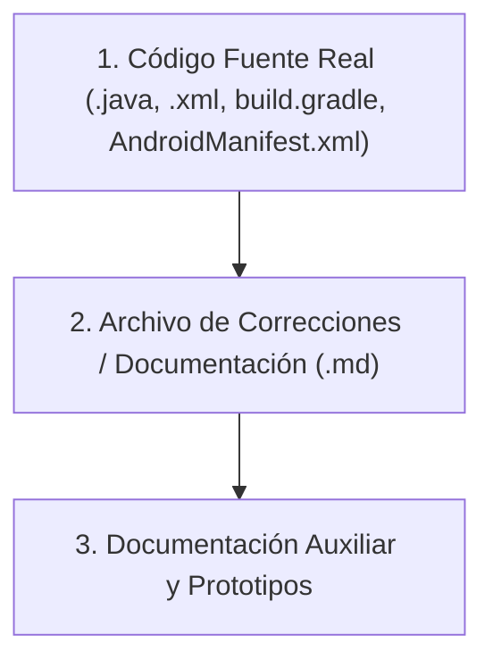
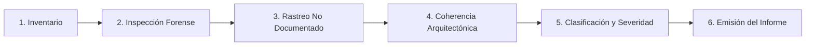

# Skill: Auditoría y Verificación Técnica de Correcciones de Software

## 1. Propósito y Postura del Auditor

El propósito de esta skill es auditar de manera forense, rigurosa e imparcial las soluciones de software y correcciones de bugs implementadas y documentadas por otros agentes o desarrolladores.

### Postura Obligatoria
- **Escepticismo Metódico:** No asumas que una corrección está bien implementada porque la redacción del documento sea convincente, profesional o detallada. La única prueba de validez es el código fuente real.
- **Cero Complacencia:** No suavices los hallazgos negativos. Si una implementación está incompleta, mal diseñada, rompe el ciclo de vida o introduce fugas de memoria, decláralo con terminología técnica directa y explícita.
- **Rigor Basado en Evidencia:** Todo señalamiento debe estar respaldado por la ruta del archivo, número de línea o fragmento de código exacto. No inventes defectos para aparentar rigurosidad ni des por sentado que una función opera sin verificar sus llamadas y efectos colaterales.
- **Solo Lectura en Auditoría:** Durante la auditoría está terminantemente prohibido modificar el código de producción del proyecto. El único entregable es el informe de auditoría.

---

## 2. Jerarquía de Fuentes de Verdad

En caso de conflicto o ambigüedad, la jerarquía de verdad es estricta:



1. **Código fuente real:** La realidad de la app compilada y su árbol de sintaxis. Si el documento afirma que una clase hace X pero el código hace Y (o no existe), el código manda y se reporta una **Discrepancia**.
2. **Archivo de correcciones (.md):** Declaración de intenciones y cambios reclamados por el autor original. Se usa como pliego de reclamos a auditar.
3. **Documentos de soporte y prototipos:** Especificaciones de diseño, diagramas de clases y contratos previos.

---

## 3. Protocolo de Auditoría Paso a Paso



### Paso 1: Inventario de Reclamos
- Leer íntegramente el archivo de correcciones.
- Desglosar cada corrección como un ítem numerado, identificando:
  - Identificador del defecto (ej. BUG 1, BUG 2).
  - Archivos declarados como afectados.
  - Objetivo y comportamiento prometido.

### Paso 2: Inspección Forense en Archivos Reales
- Abrir cada archivo real y verificar:
  - ¿El cambio documentado existe realmente en el repositorio?
  - ¿Los métodos, firmas, anotaciones y parámetros coinciden exactamente con lo publicado?
  - ¿Existen fragmentos residuales, métodos muertos o banderas sin usar?
  - ¿Coinciden las referencias cruzadas: IDs de XML con `findViewById`, claves de Intent, permisos de AndroidManifest, nombres de recursos?

### Paso 3: Rastreo de Cambios No Documentados y Huérfanos
- Ejecutar `git status` y `git diff` para detectar archivos alterados o creados que no constan en el informe.
- Buscar imports no utilizados, recursos XML definidos sin invocar, o dependencias huérfanas agregadas a Gradle.

### Paso 4: Coherencia Arquitectónica y Principios de Diseño
- Validar si la corrección respeta las fronteras de capas:
  - La capa de presentación (`Activity`/`Fragment`) no debe ejecutar consultas SQL ni contener lógica de dominio.
  - La capa de dominio debe permanecer libre de dependencias del framework de Android SDK.
  - La capa de datos debe gestionar la persistencia y mapeo entidad-modelo.
- Verificar el respeto a principios SOLID, inyección de dependencias y patrones establecidos (MVP, MVVM, Clean).

### Paso 5: Clasificación y Calificación de Severidad
- Clasificar epistemológicamente cada hallazgo:
  - **Hecho verificado:** Comprobado fehacientemente en las líneas del código fuente.
  - **Inferencia:** Deducción lógica a partir de la estructura del código y el ciclo de vida, sin ejecución dinámica completa.
  - **Duda:** Falta de información suficiente o ambigüedad estructural que requiere validación en tiempo de ejecución.
- Asignar la severidad correspondiente según la matriz de impacto.

### Paso 6: Redacción del Informe Técnico
- Generar el informe final respetando rigurosamente la plantilla estándar.

---

## 4. Criterios de Severidad y Categorización

| Severidad | Criterio de Impacto | Ejemplos Típicos |
|---|---|---|
| **Crítico** | Impide compilar la aplicación, genera un Crash inmediato (`NullPointerException`, `IllegalStateException`) o corrupción irreversible de datos en base de datos. | ID no encontrado que rompe `setContentView`, fallo sintáctico, violación de hilo principal en SQLite. |
| **Alto** | La app compila y no se cae de inmediato, pero la lógica de negocio o la funcionalidad prometida es incorrecta, hay fuga de memoria evidente o estado incoherente. | Lógica booleana invertida en botones, desincronización entre Service y Base de Datos, fuga de Fragment en Service de fondo. |
| **Medio** | Deuda técnica, inconsistencia arquitectónica menor, llamadas I/O redundantes o antipatrones que degradan el mantenimiento. | Referencias estáticas a componentes `Service`, múltiples consultas repetidas a Room en el mismo evento del ciclo de vida. |
| **Bajo** | Estilo de código, documentación desfasada, textos hardcoded menores o comentarios desactualizados. | Strings no centralizados, diferencias tipográficas menores respecto al handoff. |

---

## 5. Lista de Verificaciones Recurrentes en Android

Durante la auditoría de un proyecto Android nativo (Java/Kotlin + XML), es mandatorio ejecutar la siguiente lista de comprobaciones:

1. **Correspondencia de IDs (XML vs Java):**
   - Comprobar que cada ID referenciado en `findViewById(...)` exista con el tipo de vista exacto (`TextView`, `MaterialButton`, `Spinner`) en el layout inflado.
2. **Simetría de Temas y Recursos Day/Night:**
   - Si se modificó `res/values/colors.xml`, comprobar la existencia y equivalencia semántica de tokens en `res/values-night/colors.xml`.
   - Verificar que `res/values-night/themes.xml` establezca `android:windowLightStatusBar = false` y maneje `android:colorBackground` y `colorSurface`.
3. **Declaración en AndroidManifest.xml:**
   - Comprobar que toda `Activity`, `Service` o `BroadcastReceiver` añadido o modificado esté registrado en `AndroidManifest.xml` con sus permisos (`FOREGROUND_SERVICE`, `POST_NOTIFICATIONS`) y flags (`exported`).
4. **Ciclo de Vida y Fugas de Memoria (Memory Leaks):**
   - Detectar retención de referencias a `Context`, `Activity`, `Fragment` o `View` dentro de variables `static`, singletons o servicios de fondo.
   - Comprobar que los listeners (`setListener(null)`) se desvinculen explícitamente en `onDestroyView()` o `onDestroy()`.
5. **Concurrencia y Carrera en Base de Datos:**
   - Comprobar que ninguna operación Room/SQLite corra en el Main Thread.
   - Analizar si callbacks asíncronos concurrentes pueden sobrescribir estados de la UI de forma impredecible.
6. **Código Residual de Plantilla:**
   - Buscar restos de plantillas predeterminadas de Android Studio (ej. `com.example`, Hello World, FABs no usados).
7. **Invasión de Capas:**
   - Verificar que las Activities o Fragments no instancien directamente DAOs ni ejecuten queries SQL.

---

## 6. Plantilla Estándar del Informe de Auditoría

Todo informe generado bajo esta skill debe estructurarse obligatoriamente de la siguiente manera:

```markdown
# Informe de Auditoría Técnica y Verificación de Correcciones

## 1. Resumen Ejecutivo
[3 a 5 líneas con métricas exactas: correcciones verificadas, correctas, con problemas y principal riesgo técnico]

## 2. Tabla de Verificación de Correcciones Documentadas
| # | Corrección Reclamada | Archivo Afectado | Estado | Evidencia Concreta |
|---|---|---|:---:|---|
| 1 | [Nombre / Resumen] | [Ruta] | Verificada / Parcial / No implementada / Incorrecta / No verificable | [Ruta y líneas de código] |

## 3. Hallazgos Detallados
### Hallazgo [N]: [Título Descriptivo]
- **Severidad:** Crítico / Alto / Medio / Bajo
- **Categoría:** Hecho verificado / Inferencia / Duda
- **Descripción:** [Explicación técnica del defecto o inconsistencia]
- **Evidencia:** [Fragmento de código y ubicación exacta]
- **Impacto:** [Consecuencias técnicas o de experiencia de usuario]
- **Acción Recomendada:** [Instrucción técnica precisa para corregirlo]

## 4. Discrepancias entre Documentación y Código Fuente
[Listado de contradicciones directas entre lo que afirma el .md y lo que ejecuta el código]

## 5. Cambios No Documentados Detectados
[Archivos, clases o métodos modificados o añadidos en el repositorio que el .md omitió]

## 6. Implementaciones Correctas y Fortalezas Técnicas
[Aspectos que sí cumplen con los estándares, demostrados con evidencia concreta]

## 7. Límites y Alcance del Análisis
[Restricciones del entorno: ausencia de emulador, pruebas de hardware no disponibles, etc.]
```
