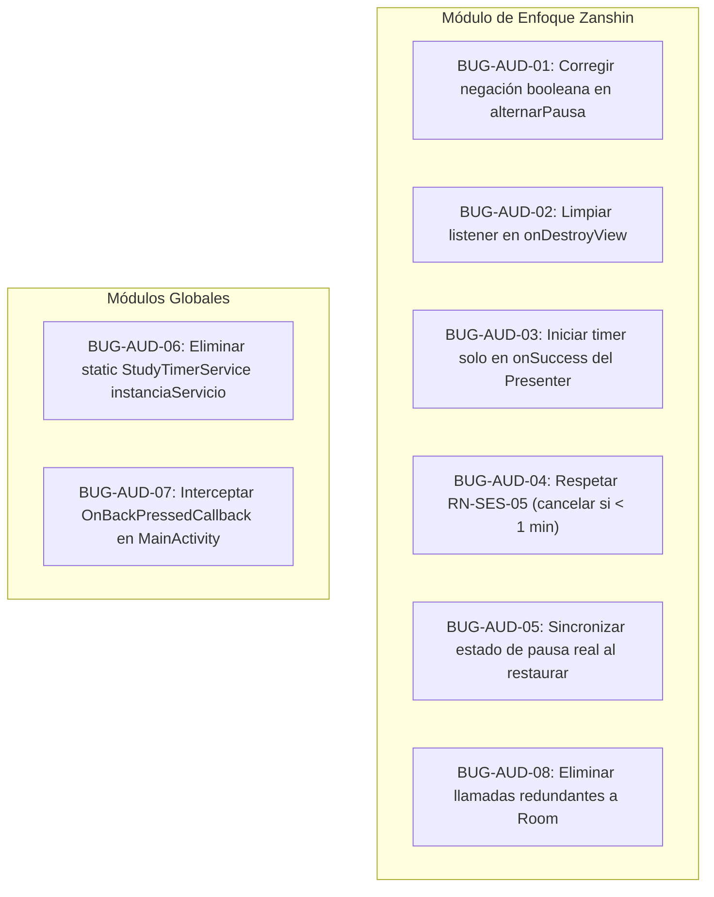

# VibeStudy: Guía de Corrección e Implementación de Bugs Auditados

> **Documento:** `BUG-ANALIZADOS.md`  
> **Destinatario:** Agente de Implementación / Desarrollador Android  
> **Origen:** Informe de Auditoría Técnica Senior sobre [`INFORME_BUGS_Y_CORRECCIONES.md`](file:///home/gorena/Escritorio/Proyecto%20AppMoviles/VibeStudy/INFORME_BUGS_Y_CORRECCIONES.md)  
> **Proyecto:** VibeStudy - Aplicación Android Nativa (Java, XML, Room SQLite, MVP)  
> **Fecha:** 11 de Noviembre de 2026  
> **Estado:** Listo para análisis e implementación directa  

---

## 1. Resumen de la Auditoría

El agente anterior resolvió exitosamente la paleta nocturna de Material Design 3 ([`res/values-night/colors.xml`](file:///home/gorena/Escritorio/Proyecto%20AppMoviles/VibeStudy/app/src/main/res/values-night/colors.xml)) y la sentencia SQL de saneamiento de sesiones huérfanas al arrancar el dispositivo ([`SesionEstudioDao.java`](file:///home/gorena/Escritorio/Proyecto%20AppMoviles/VibeStudy/app/src/main/java/com/david/mystudio/data/local/dao/SesionEstudioDao.java)).

Sin embargo, la auditoría forense identificó **8 defectos técnicos pendientes en la capa de presentación y ciclo de vida** que deben ser corregidos obligatoriamente para garantizar la estabilidad, evitar fugas de memoria y asegurar que la lógica de negocio se cumpla con exactitud.

---

## 2. Matriz de Bugs Pendientes de Implementación

| ID | Defecto / Vulnerabilidad | Severidad | Capa | Archivo Principal |
|---|---|:---:|:---:|---|
| **BUG-AUD-01** | Inversión de lógica booleana en pausa/reanudación de UI | **Alto** | UI / Presenter | [`EnfoquePresenter.java`](file:///home/gorena/Escritorio/Proyecto%20AppMoviles/VibeStudy/app/src/main/java/com/david/mystudio/ui/enfoque/EnfoquePresenter.java) |
| **BUG-AUD-02** | Fuga de memoria (`Memory Leak`) del Fragment en Service | **Alto** | UI / Lifecycle | [`EnfoqueFragment.java`](file:///home/gorena/Escritorio/Proyecto%20AppMoviles/VibeStudy/app/src/main/java/com/david/mystudio/ui/enfoque/EnfoqueFragment.java) |
| **BUG-AUD-03** | Condición de carrera: arranque del timer antes de guardar en BD | **Alto** | UI / Concurrencia | [`EnfoqueFragment.java`](file:///home/gorena/Escritorio/Proyecto%20AppMoviles/VibeStudy/app/src/main/java/com/david/mystudio/ui/enfoque/EnfoqueFragment.java) |
| **BUG-AUD-04** | Violación de `RN-SES-05`: forzado de 1 min en sesiones de segundos | **Alto** | Dominio / MVP | [`EnfoquePresenter.java`](file:///home/gorena/Escritorio/Proyecto%20AppMoviles/VibeStudy/app/src/main/java/com/david/mystudio/ui/enfoque/EnfoquePresenter.java) |
| **BUG-AUD-05** | Sobrescritura incorrecta del estado de pausa al restaurar vista | **Medio** | UI / Presenter | [`EnfoquePresenter.java`](file:///home/gorena/Escritorio/Proyecto%20AppMoviles/VibeStudy/app/src/main/java/com/david/mystudio/ui/enfoque/EnfoquePresenter.java) |
| **BUG-AUD-06** | Antipatrón: referencia estática a instancia de Android `Service` | **Medio** | Arquitectura | [`StudyTimerService.java`](file:///home/gorena/Escritorio/Proyecto%20AppMoviles/VibeStudy/app/src/main/java/com/david/mystudio/ui/enfoque/StudyTimerService.java) |
| **BUG-AUD-07** | Evasión de advertencia de sesión activa con botón Atrás (`Back`) | **Medio** | UI / Navegación | [`MainActivity.java`](file:///home/gorena/Escritorio/Proyecto%20AppMoviles/VibeStudy/app/src/main/java/com/david/mystudio/MainActivity.java) |
| **BUG-AUD-08** | Consultas asíncronas redundantes a Room en el ciclo de vida | **Medio** | Optimización I/O | [`EnfoqueFragment.java`](file:///home/gorena/Escritorio/Proyecto%20AppMoviles/VibeStudy/app/src/main/java/com/david/mystudio/ui/enfoque/EnfoqueFragment.java) |

---

## 3. Especificación Técnica Detallada de Corrección



---

### BUG-AUD-01: Inversión de lógica booleana en alternarPausa

#### Archivo Afectado
* [`app/src/main/java/com/david/mystudio/ui/enfoque/EnfoquePresenter.java`](file:///home/gorena/Escritorio/Proyecto%20AppMoviles/VibeStudy/app/src/main/java/com/david/mystudio/ui/enfoque/EnfoquePresenter.java#L91-L95)

#### Causa Raíz
En el método `alternarPausa(boolean estaPausado)`, se le pasa a la vista `!estaPausado`. Cuando el usuario pulsa pausar (`estaPausado = true`), la vista recibe `false`, por lo que el texto y el ícono quedan trabados en "Activo / Pausar" mientras el reloj está detenido.

#### Código Actual (Líneas 91-95)
```java
@Override
public void alternarPausa(boolean estaPausado) {
    if (vista != null) {
        vista.actualizarEstadoSesion(sesionActiva != null, !estaPausado);
    }
}
```

#### Código Propuesto (Solución)
```java
@Override
public void alternarPausa(boolean estaPausado) {
    if (vista != null) {
        vista.actualizarEstadoSesion(sesionActiva != null, estaPausado);
    }
}
```

---

### BUG-AUD-02: Fuga de memoria (`Memory Leak`) del Fragment en Service

#### Archivo Afectado
* [`app/src/main/java/com/david/mystudio/ui/enfoque/EnfoqueFragment.java`](file:///home/gorena/Escritorio/Proyecto%20AppMoviles/VibeStudy/app/src/main/java/com/david/mystudio/ui/enfoque/EnfoqueFragment.java#L136-L158)

#### Causa Raíz
`EnfoqueFragment` registra `timerService.setListener(EnfoqueFragment.this)` al conectar el servicio. En `onDestroyView()`, se ejecuta `desenlazarServicio()`, pero **nunca** se desvincula el listener (`timerService.setListener(null)`). Dado que `StudyTimerService` continúa corriendo en primer plano como servicio persistente, retiene en memoria la instancia destruida del fragmento, provocando un memory leak en cada cambio de pestaña.

#### Código Propuesto (Solución)
En `EnfoqueFragment.java`:
```java
@Override
public void onDestroyView() {
    super.onDestroyView();
    if (timerService != null) {
        timerService.setListener(null);
    }
    desenlazarServicio();
    if (presenter != null) {
        presenter.desvincularVista();
    }
}
```

---

### BUG-AUD-03: Desincronización y condición de carrera en inicio de sesión

#### Archivos Afectados
* [`app/src/main/java/com/david/mystudio/ui/enfoque/EnfoqueFragment.java`](file:///home/gorena/Escritorio/Proyecto%20AppMoviles/VibeStudy/app/src/main/java/com/david/mystudio/ui/enfoque/EnfoqueFragment.java#L91-L101)
* [`app/src/main/java/com/david/mystudio/ui/enfoque/EnfoqueContract.java`](file:///home/gorena/Escritorio/Proyecto%20AppMoviles/VibeStudy/app/src/main/java/com/david/mystudio/ui/enfoque/EnfoqueContract.java)
* [`app/src/main/java/com/david/mystudio/ui/enfoque/EnfoquePresenter.java`](file:///home/gorena/Escritorio/Proyecto%20AppMoviles/VibeStudy/app/src/main/java/com/david/mystudio/ui/enfoque/EnfoquePresenter.java#L64-L88)

#### Causa Raíz
Al presionar el botón "Iniciar", el fragmento lanza `presenter.iniciarSesion(...)` (asíncrono en Room) e **inmediatamente** arranca `timerService.iniciar(0)`. Si la base de datos rechaza la creación (por ejemplo, por fallo de I/O o si ya existía una sesión activa), el temporizador queda corriendo en primer plano sin que exista un registro asociado en la tabla SQLite. Luego, al finalizar la sesión, el presenter falla diciendo que no hay sesión activa.

#### Solución Recomendada
1. En `EnfoqueContract.View`, añadir el método:
   ```java
   void iniciarTemporizadorVisual(int segundosIniciales);
   ```
2. En `EnfoqueFragment.java`, no invocar `timerService.iniciar(0)` dentro del listener del botón, sino implementarlo en la vista:
   ```java
   @Override
   public void iniciarTemporizadorVisual(int segundosIniciales) {
       if (timerService != null) {
           timerService.iniciar(segundosIniciales);
       }
   }
   ```
3. En `EnfoquePresenter.java`, llamar a `vista.iniciarTemporizadorVisual(0)` **únicamente** dentro del bloque `onSuccess`:
   ```java
   @Override
   public void onSuccess(SesionEstudio sesion) {
       sesionActiva = sesion;
       segundosActuales = 0;
       if (vista != null) {
           vista.mostrarCargando(false);
           vista.actualizarEstadoSesion(true, false);
           vista.iniciarTemporizadorVisual(0);
       }
   }
   ```

---

### BUG-AUD-04: Violación de `RN-SES-05` (Forzado artificial de 1 min)

#### Archivo Afectado
* [`app/src/main/java/com/david/mystudio/ui/enfoque/EnfoquePresenter.java`](file:///home/gorena/Escritorio/Proyecto%20AppMoviles/VibeStudy/app/src/main/java/com/david/mystudio/ui/enfoque/EnfoquePresenter.java#L98-L129)

#### Causa Raíz
La regla de negocio `RN-SES-05` indica que sesiones con tiempo inferior a 1 minuto no son válidas y deben descartarse/cancelarse sin sumar avance. Sin embargo, la línea 104 de `EnfoquePresenter` ejecuta:
```java
int minutosEfectivos = Math.max(1, segundosActuales / 60);
```
Si el usuario estudia 5 segundos y presiona "Finalizar", `segundosActuales / 60` es `0`, pero `Math.max(1, 0)` devuelve `1`. El sistema guarda una sesión `COMPLETADA` sumando 1 minuto a la meta semanal.

#### Código Propuesto (Solución)
Delegar en `sesionEstudioService.finalizarOCancelarSesionActiva` (que ya implementa la regla completa):
```java
@Override
public void finalizarSesion(String notas) {
    if (sesionActiva == null) {
        if (vista != null) vista.mostrarError("No hay una sesión activa para finalizar");
        return;
    }

    if (vista != null) vista.mostrarCargando(true);

    int minutos = segundosActuales / 60;
    sesionEstudioService.finalizarOCancelarSesionActiva(segundosActuales, notas, new SesionEstudioService.ResultadoCallback<Void>() {
        @Override
        public void onSuccess(Void resultado) {
            sesionActiva = null;
            segundosActuales = 0;
            if (vista != null) {
                vista.mostrarCargando(false);
                vista.actualizarEstadoSesion(false, false);
                vista.actualizarTiempo("25:00");
                vista.limpiarNotas();
                if (minutos >= 1) {
                    vista.mostrarResumenSesionCompletada("Sesión completada y guardada con éxito (" + minutos + " min)");
                } else {
                    vista.mostrarResumenSesionCompletada("Sesión cancelada: tiempo inferior a 1 minuto.");
                }
            }
        }

        @Override
        public void onError(String mensajeError) {
            if (vista != null) {
                vista.mostrarCargando(false);
                vista.mostrarError(mensajeError);
            }
        }
    });
}
```

---

### BUG-AUD-05: Sobrescritura forzada del estado de pausa al restaurar sesión

#### Archivo Afectado
* [`app/src/main/java/com/david/mystudio/ui/enfoque/EnfoquePresenter.java`](file:///home/gorena/Escritorio/Proyecto%20AppMoviles/VibeStudy/app/src/main/java/com/david/mystudio/ui/enfoque/EnfoquePresenter.java#L395-L414)

#### Causa Raíz
En `restaurarSesionActivaSiExiste()`, la línea 404 ejecuta:
```java
vista.actualizarEstadoSesion(true, false);
```
El segundo parámetro (`pausado`) está quemado en `false`. Si el usuario había pausado el estudio antes de navegar a otra pestaña o minimizar la app, la resolución asíncrona de Room sobreescribe la UI mostrándola como "Activa" y no "En Pausa".

#### Código Propuesto (Solución)
Verificar si el servicio está corriendo y si está en pausa antes de actualizar la vista:
```java
@Override
public void restaurarSesionActivaSiExiste() {
    sesionEstudioService.obtenerSesionActiva(new SesionEstudioService.ResultadoCallback<SesionEstudio>() {
        @Override
        public void onSuccess(SesionEstudio sesion) {
            if (sesion != null) {
                sesionActiva = sesion;
                tecnicaActual = sesion.getTecnica() != null ? sesion.getTecnica() : TipoTecnica.POMODORO;
                if (vista != null) {
                    vista.seleccionarMateriaActiva(sesion.getIdMateria());
                    boolean estaPausado = StudyTimerService.isSesionPausada();
                    vista.actualizarEstadoSesion(true, estaPausado);
                }
            }
        }

        @Override
        public void onError(String mensajeError) {
            // Sin sesión activa previa
        }
    });
}
```

---

### BUG-AUD-06: Antipatrón: referencia estática a instancia de Android `Service`

#### Archivo Afectado
* [`app/src/main/java/com/david/mystudio/ui/enfoque/StudyTimerService.java`](file:///home/gorena/Escritorio/Proyecto%20AppMoviles/VibeStudy/app/src/main/java/com/david/mystudio/ui/enfoque/StudyTimerService.java#L27,L37-L44,L81,L89)

#### Causa Raíz
Mantener `private static StudyTimerService instanciaServicio = null;` viola las buenas prácticas de Android al retener un `Context` en memoria estática.

#### Código Propuesto (Solución)
1. Definir una acción de Intent en `StudyTimerService`:
   ```java
   public static final String ACTION_DETENER = "com.david.mystudio.ACTION_DETENER_TIMER";
   ```
2. Atender la acción en `onStartCommand`:
   ```java
   @Override
   public int onStartCommand(Intent intent, int flags, int startId) {
       if (intent != null && ACTION_DETENER.equals(intent.getAction())) {
           detener();
           return START_NOT_STICKY;
       }
       if (estaCorriendo) {
           try {
               startForeground(NOTIFICACION_ID, construirNotificacion());
           } catch (SecurityException ignored) {
           }
       }
       return START_NOT_STICKY;
   }
   ```
3. Implementar `detenerServicio(Context context)` enviando el Intent en lugar de invocar la instancia estática:
   ```java
   public static void detenerServicio(android.content.Context context) {
       servicioCorriendo = false;
       if (context != null) {
           Intent intent = new Intent(context, StudyTimerService.class);
           intent.setAction(ACTION_DETENER);
           context.startService(intent);
       }
   }
   ```
4. Eliminar por completo el campo `private static StudyTimerService instanciaServicio;`.

---

### BUG-AUD-07: Evasión de advertencia con botón Atrás (`onBackPressed`)

#### Archivo Afectado
* [`app/src/main/java/com/david/mystudio/MainActivity.java`](file:///home/gorena/Escritorio/Proyecto%20AppMoviles/VibeStudy/app/src/main/java/com/david/mystudio/MainActivity.java)

#### Causa Raíz
La navegación se intercepta únicamente en `navInferior.setOnItemSelectedListener`. Si el usuario presiona el botón físico o gesto de "Atrás" mientras estudia, `MainActivity` se cierra sin previo aviso, dejando el Foreground Service ejecutándose desvinculado.

#### Código Propuesto (Solución)
En `MainActivity.onCreate()`:
```java
getOnBackPressedDispatcher().addCallback(this, new androidx.activity.OnBackPressedCallback(true) {
    @Override
    public void handleOnBackPressed() {
        if (StudyTimerService.isSesionEnCurso()) {
            mostrarDialogoAdvertenciaSesion(pestanaActualId);
        } else {
            setEnabled(false);
            getOnBackPressedDispatcher().onBackPressed();
        }
    }
});
```

---

### BUG-AUD-08: Consultas asíncronas redundantes a Room en el ciclo de vida

#### Archivo Afectado
* [`app/src/main/java/com/david/mystudio/ui/enfoque/EnfoqueFragment.java`](file:///home/gorena/Escritorio/Proyecto%20AppMoviles/VibeStudy/app/src/main/java/com/david/mystudio/ui/enfoque/EnfoqueFragment.java)

#### Causa Raíz
`presenter.restaurarSesionActivaSiExiste()` se dispara de manera simultánea en:
1. `onServiceConnected` (línea 52)
2. `onResume` (línea 131)
3. `mostrarMaterias` (línea 170)

#### Código Propuesto (Solución)
- Eliminar la llamada en `mostrarMaterias`: cuando las materias terminan de cargar, el spinner se puebla normalmente; si existe una sesión activa, el callback de `restaurarSesionActivaSiExiste` invoca `seleccionarMateriaActiva(idMateria)` sin necesidad de reconsultar la base de datos completa.
- Mantener la restauración únicamente en `onServiceConnected` (si el servicio ya estaba activo) y en `onResume` si el servicio no está enlazado todavía.

---

## 4. Plan de Ejecución Recomendado para el Agente

1. **Paso 1:** Abrir [`EnfoquePresenter.java`](file:///home/gorena/Escritorio/Proyecto%20AppMoviles/VibeStudy/app/src/main/java/com/david/mystudio/ui/enfoque/EnfoquePresenter.java) y corregir la inversión booleana de `alternarPausa` (**BUG-AUD-01**) y el cálculo de tiempo mínimo en `finalizarSesion` (**BUG-AUD-04**).
2. **Paso 2:** Abrir [`EnfoqueFragment.java`](file:///home/gorena/Escritorio/Proyecto%20AppMoviles/VibeStudy/app/src/main/java/com/david/mystudio/ui/enfoque/EnfoqueFragment.java) y agregar `timerService.setListener(null)` en `onDestroyView()` (**BUG-AUD-02**), eliminando la llamada duplicada en `mostrarMaterias` (**BUG-AUD-08**).
3. **Paso 3:** Enlazar el inicio del timer visual a la respuesta exitosa del Presenter (**BUG-AUD-03**).
4. **Paso 4:** Refactorizar [`StudyTimerService.java`](file:///home/gorena/Escritorio/Proyecto%20AppMoviles/VibeStudy/app/src/main/java/com/david/mystudio/ui/enfoque/StudyTimerService.java) eliminando la referencia estática al servicio (**BUG-AUD-06**).
5. **Paso 5:** Registrar el `OnBackPressedCallback` en [`MainActivity.java`](file:///home/gorena/Escritorio/Proyecto%20AppMoviles/VibeStudy/app/src/main/java/com/david/mystudio/MainActivity.java) (**BUG-AUD-07**).
6. **Paso 6:** Ejecutar compilación y pruebas unitarias:
   ```bash
   ./gradlew compileDebugJavaWithJavac
   ./gradlew test
   ```

---

## 5. Registro de Implementación y Verificación de Correcciones (Completado)

| ID | Severidad | Estado | Archivo Modificado | Resumen del Cambio | Método de Verificación |
|---|:---:|:---:|---|---|---|
| **BUG-AUD-01** | Alto | **Corregido** | `EnfoquePresenter.java` | Se corrigió la negación booleana `!estaPausado` pasando directamente `estaPausado` a `vista.actualizarEstadoSesion`. | Verificación estática + `compileDebugJavaWithJavac` |
| **BUG-AUD-02** | Alto | **Corregido** | `EnfoqueFragment.java` | Se agregó `timerService.setListener(null)` en `onDestroyView()` antes de desenlazar el servicio. | Verificación estática + `compileDebugJavaWithJavac` |
| **BUG-AUD-03** | Alto | **Corregido** | `EnfoqueContract.java`, `EnfoquePresenter.java`, `EnfoqueFragment.java` | Se incorporó `iniciarTemporizadorVisual(int)` al contrato; la vista ya no inicia el timer anticipadamente sino en `onSuccess` del presenter. | Verificación estática + `compileDebugJavaWithJavac` |
| **BUG-AUD-04** | Alto | **Corregido** | `EnfoquePresenter.java` | Se eliminó `Math.max(1, segundos / 60)` delegando en `sesionEstudioService.finalizarOCancelarSesionActiva` (cumpliendo `RN-SES-05`). | Verificación estática + `compileDebugJavaWithJavac` + `test` |
| **BUG-AUD-05** | Medio | **Corregido** | `StudyTimerService.java`, `EnfoquePresenter.java` | Se expuso `StudyTimerService.isSesionPausada()` y se sincronizó el estado booleano real en `restaurarSesionActivaSiExiste()`. | Verificación estática + `compileDebugJavaWithJavac` |
| **BUG-AUD-06** | Medio | **Corregido** | `StudyTimerService.java` | Se erradicó la referencia estática `instanciaServicio`, controlando la detención externa mediante Intent con `ACTION_DETENER`. | Verificación estática + `compileDebugJavaWithJavac` |
| **BUG-AUD-07** | Medio | **Corregido** | `MainActivity.java` | Se registró `OnBackPressedCallback` en `onCreate()` evaluando `StudyTimerService.isSesionEnCurso()` para advertir antes de salir. | Verificación estática + `compileDebugJavaWithJavac` |
| **BUG-AUD-08** | Medio | **Corregido** | `EnfoqueFragment.java` | Se suprimió la llamada redundante a `restaurarSesionActivaSiExiste()` dentro de `mostrarMaterias()`. | Verificación estática + `compileDebugJavaWithJavac` + `assembleDebug` |

