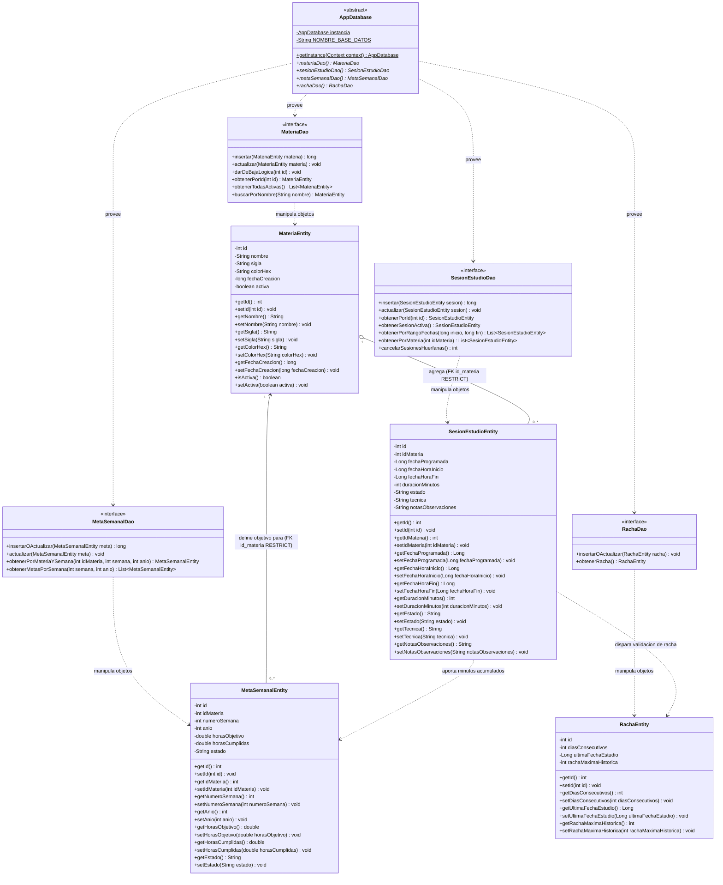

# StudyVibe: Diagrama de Base de Datos Orientada a Objetos (ORM Room)

> **Institución:** Universidad Privada Domingo Savio (UPDS)  
> **Facultad:** Ingeniería  
> **Carrera:** Ingeniería de Sistemas  
> **Materia:** Aplicaciones Móviles I  
> **Docente:** Ing. Daniel Román Terrazas  
> **Estudiante:** David Gorena  
> **Gestión:** II / 2026  
> **Tipo de Diagrama:** Base de Datos Orientada a Objetos (Mapeo Objeto-Relacional con Room)  
> **Herramienta de Modelado:** Enterprise Architect (EA) / Mermaid UML  

---

## 1. Fundamentación Teórica del Diseño Orientado a Objetos

En el desarrollo de aplicaciones Android modernas, la persistencia de datos no se concibe como un simple modelo relacional tabular plano (Entidad-Relación tradicional), sino bajo el paradigma de **Base de Datos Orientada a Objetos mediante Mapeo Objeto-Relacional (ORM)** provisto por la biblioteca oficial **AndroidX Room** (Google Developers, 2023).

Bajo este enfoque:
1. **Las Tablas son Clases de Entidad (`@Entity`):** Cada registro de base de datos es una instancia viva de una clase Java con encapsulamiento estricto (`private fields`, `getters`, `setters` y constructores).
2. **Las Relaciones son Asociaciones y Agregaciones entre Objetos:** La entidad `MateriaEntity` agrega colecciones de objetos `SesionEstudioEntity` y se vincula a objetos `MetaSemanalEntity`. La multiplicidad se expresa mediante asociaciones orientadas a objetos mediadas por claves foráneas.
3. **Las Operaciones son Contratos de Acceso a Objetos (`@Dao`):** Los *Data Access Objects* operan directamente sobre tipos y colecciones de objetos de software (`List<MateriaEntity>`, `SesionEstudioEntity`), abstrayendo al programador de las sentencias SQL nativas y devolviendo instancias tipadas en memoria.
4. **La Base de Datos es un Objeto Central Singleton (`AppDatabase`):** Extiende de `RoomDatabase` y expone métodos fábrica abstractos para obtener las instancias de cada DAO.

---

## 2. Diagrama de Clases de la Base de Datos Orientada a Objetos (Código Mermaid)

---

## 3. Especificación de Componentes y Guía para Enterprise Architect (EA)

Si vas a replicar este diagrama en **Enterprise Architect (EA)** o a dibujarlo a mano:

1. **Tipo de Diagrama en EA:** Crear un *Class Diagram* (Diagrama de Clases UML).
2. **Estereotipos y Clases:**
   * La clase `AppDatabase` lleva el estereotipo `<<abstract>>` y contiene métodos abstractos que retornan interfaces DAO.
   * Las interfaces `MateriaDao`, `SesionEstudioDao`, `MetaSemanalDao` y `RachaDao` llevan el estereotipo `<<interface>>`.
   * Las 4 clases de entidad (`MateriaEntity`, `SesionEstudioEntity`, `MetaSemanalEntity`, `RachaEntity`) representan las tablas de Room mapeadas como objetos con visibilidad privada (`-`) en atributos y pública (`+`) en getters/setters.
3. **Multiplicidades y Relaciones:**
   * **Agregación Compartida (`o--`):** De `MateriaEntity` (1) a `SesionEstudioEntity` (0..*), indicando que las sesiones pertenecen conceptualmente a una materia. La clave foránea `id_materia` posee integridad referencial restrictiva (`RESTRICT`).
   * **Asociación Dirigida (`<--`):** De `MetaSemanalEntity` (0..*) a `MateriaEntity` (1), con índice único compuesto sobre `(id_materia, numero_semana, anio)`.
   * **Objeto Singleton:** `RachaEntity` mantiene un identificador fijo `id = 1` para garantizar la persistencia del estado diario del usuario en una única instancia.
   * **Dependencias de Uso (`..>`):** Las interfaces DAO dependen de sus respectivas entidades de datos para operaciones tipadas (`List<T>`).
