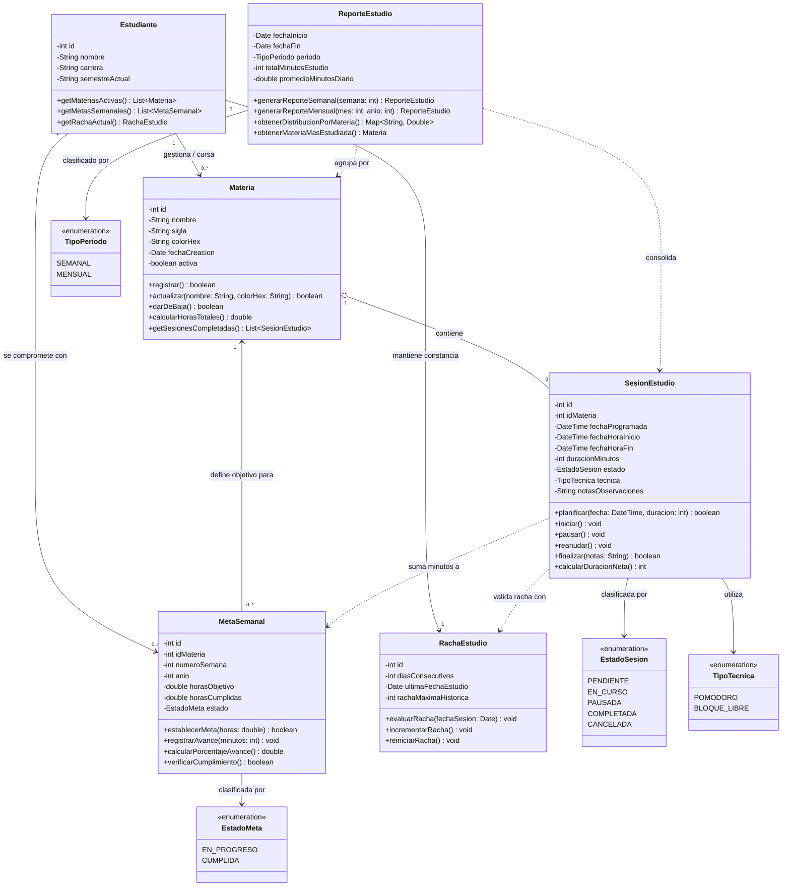

# VibeStudy: Modelo del Dominio (Diagrama de Clases)

> **Materia:** Aplicaciones Móviles I  
> **Institución:** Universidad Privada Domingo Savio (UPDS)  
> **Docente:** Ing. Daniel Román Terrazas  
> **Estudiante:** David Gorena  
> **Ubicación en el Proyecto:** Capítulo 3, Sección 3.3.3 (*Modelado del Dominio*)  
> **Consigna Asociada:** Producto 1 de [Flujo-de-requisitos.md](file:///home/devgorena/Documentos/UPDS/AppMoviles/Proyecto%20Documentacion/Flujo-de-requisitos.md) y [NuevoDoc.md](file:///home/devgorena/Documentos/UPDS/AppMoviles/Proyecto%20Documentacion/NuevoDoc.md)

---

## 1. Diagrama de Clases Conceptual (Mermaid)

El siguiente diagrama modela las entidades del dominio de **VibeStudy**, sus atributos esenciales, métodos principales, tipos de datos, enumeraciones y cardinalidades, respondiendo punto por punto a las 12 Historias de Usuario (`HU-01` a `HU-12`):

---

## 2. Descripción Detallada de las Clases y Métodos

### 2.1. Clase `Materia`
* **Propósito:** Representa una asignatura académica registrada por el estudiante en el semestre lectivo (alineada al método 5S de organización).
* **Historias de Usuario asociadas:** `HU-01` (Registro), `HU-02` (Colorimetría/Edición), `HU-03` (Baja lógica).
* **Atributos:**
  * `id`: Identificador único auto-incremental en SQLite.
  * `nombre`: Denominación oficial de la materia (ej. "Aplicaciones Móviles I").
  * `sigla`: Código alfanumérico identificador (ej. "INF-312").
  * `colorHex`: Cadena hexadecimal que identifica visualmente la materia en calendarios y gráficos (ej. `"#263238"`).
  * `activa`: Bandera booleana para borrado lógico, preservando la integridad del historial.
* **Métodos principales:**
  * `registrar()`: Persiste la asignatura previa validación de no-duplicidad.
  * `actualizar(...)`: Modifica nombre, código o color reflejando cambios en toda la interfaz.
  * `calcularHorasTotales()`: Suma la duración neta de todas las sesiones con estado `COMPLETADA`.

### 2.2. Clase `SesionEstudio`
* **Propósito:** Gestiona las unidades de tiempo de estudio planificadas o ejecutadas en tiempo real bajo el modo de concentración *Zanshin*.
* **Historias de Usuario asociadas:** `HU-04` (Planificación futura), `HU-05` (Cronómetro interactivo), `HU-06` (Pausas y notas).
* **Atributos:**
  * `id`: Identificador único de la sesión.
  * `idMateria`: Clave foránea que referencia a la materia asociada.
  * `fechaProgramada`: Fecha y hora para sesiones de estudio agendadas a futuro.
  * `fechaHoraInicio` / `fechaHoraFin`: Marcas temporales de ejecución en tiempo real.
  * `duracionMinutos`: Tiempo efectivo contabilizado.
  * `estado`: Instancia de `EstadoSesion` (`PENDIENTE`, `EN_CURSO`, `PAUSADA`, `COMPLETADA`, `CANCELADA`).
  * `tecnica`: Instancia de `TipoTecnica` (`POMODORO` o `BLOQUE_LIBRE`).
  * `notasObservaciones`: Anotaciones cualitativas sobre los temas abordados.
* **Métodos principales:**
  * `planificar(...)`: Crea una sesión a futuro con estado `PENDIENTE`.
  * `iniciar()`: Inicializa el cronómetro y cambia el estado a `EN_CURSO`.
  * `pausar()` / `reanudar()`: Detiene o continúa el conteo sin pérdida de minutos.
  * `finalizar(notas)`: Calcula la duración neta, cambia el estado a `COMPLETADA`, anexa notas y persiste en la base de datos local.

### 2.3. Clase `MetaSemanal`
* **Propósito:** Modela el compromiso cuantitativo de horas de estudio por asignatura para una semana específica, sustentando la filosofía *Kaizen*.
* **Historias de Usuario asociadas:** `HU-07` (Fijar meta 1 a 50 hrs), `HU-08` (Progreso dinámico y felicitación al 100%).
* **Atributos:**
  * `id`: Identificador único de la meta.
  * `idMateria`: Asignatura asociada a la meta.
  * `numeroSemana` y `anio`: Periodo del calendario lectivo.
  * `horasObjetivo`: Umbral de dedicación semanal fijado por el usuario (entre 1 y 50 horas).
  * `horasCumplidas`: Sumatoria acumulada de horas a partir de las sesiones completadas en esa semana.
  * `estado`: Instancia de `EstadoMeta` (`EN_PROGRESO` o `CUMPLIDA`).
* **Métodos principales:**
  * `establecerMeta(...)`: Registra o actualiza la meta para la semana en curso.
  * `registrarAvance(minutos)`: Incrementa las horas cumplidas al concluir una sesión.
  * `calcularPorcentajeAvance()`: Retorna el ratio porcentual `(horasCumplidas / horasObjetivo) * 100`.
  * `verificarCumplimiento()`: Evalúa si se alcanzó el 100% para emitir la notificación de meta cumplida.

### 2.4. Clase `RachaEstudio`
* **Propósito:** Mide la regularidad del estudiante premiando la constancia diaria mediante el principio de hábito acumulativo.
* **Historia de Usuario asociada:** `HU-12` (Racha de días consecutivos).
* **Atributos:**
  * `diasConsecutivos`: Número de días seguidos con al menos una sesión completada.
  * `ultimaFechaEstudio`: Fecha calendario de la última sesión finalizada con éxito.
  * `rachaMaximaHistorica`: Récord histórico alcanzado por el alumno.
* **Métodos principales:**
  * `evaluarRacha(fechaSesion)`: Comprueba si la sesión corresponde al día de hoy, ayer (incrementa) o si transcurrieron más de 48 horas sin actividad (reinicia a 0).

### 2.5. Clase `ReporteEstudio`
* **Propósito:** Entidad de agregación y análisis que procesa el histórico de sesiones para generar la analítica visual.
* **Historias de Usuario asociadas:** `HU-09` (Reporte semanal), `HU-10` (Histórico mensual), `HU-11` (Distribución PieChart).
* **Atributos:**
  * `fechaInicio` / `fechaFin`: Rango temporal evaluado.
  * `periodo`: Instancia de `TipoPeriodo` (`SEMANAL` o `MENSUAL`).
  * `totalMinutosEstudio`: Sumatoria global de tiempo en el intervalo.
  * `promedioMinutosDiario`: Media aritmética de minutos de estudio por día.
* **Métodos principales:**
  * `obtenerDistribucionPorMateria()`: Retorna un mapa asociativo `[NombreMateria -> Porcentaje]` utilizado para renderizar el gráfico circular (*PieChart*).
  * `obtenerMateriaMasEstudiada()`: Determina la asignatura con mayor inversión de horas en el ciclo.

---

## 3. Matriz de Trazabilidad: Clases vs. Historias de Usuario

| Historia de Usuario | Título de la Historia | Clase Principal | Clases de Apoyo |
| :---: | :--- | :---: | :---: |
| **HU-01** | Registrar nueva materia académica | `Materia` | `Estudiante` |
| **HU-02** | Modificar y asignar color identificador | `Materia` | - |
| **HU-03** | Visualizar y dar de baja materias activas | `Materia` | `SesionEstudio` |
| **HU-04** | Planificar sesión de estudio a futuro | `SesionEstudio` | `Materia`, `EstadoSesion` |
| **HU-05** | Iniciar sesión en tiempo real con cronómetro | `SesionEstudio` | `TipoTecnica`, `EstadoSesion` |
| **HU-06** | Pausar, reanudar y registrar notas | `SesionEstudio` | - |
| **HU-07** | Establecer meta semanal por materia | `MetaSemanal` | `Materia` |
| **HU-08** | Consultar progreso de las metas semanales | `MetaSemanal` | `EstadoMeta`, `SesionEstudio` |
| **HU-09** | Reporte semanal del tiempo total de estudio | `ReporteEstudio` | `SesionEstudio`, `TipoPeriodo` |
| **HU-10** | Consultar desglose histórico mensual de horas | `ReporteEstudio` | `SesionEstudio`, `Materia` |
| **HU-11** | Gráfico de distribución de tiempo (PieChart) | `ReporteEstudio` | `Materia` |
| **HU-12** | Monitorear racha de días consecutivos | `RachaEstudio` | `SesionEstudio`, `Estudiante` |
