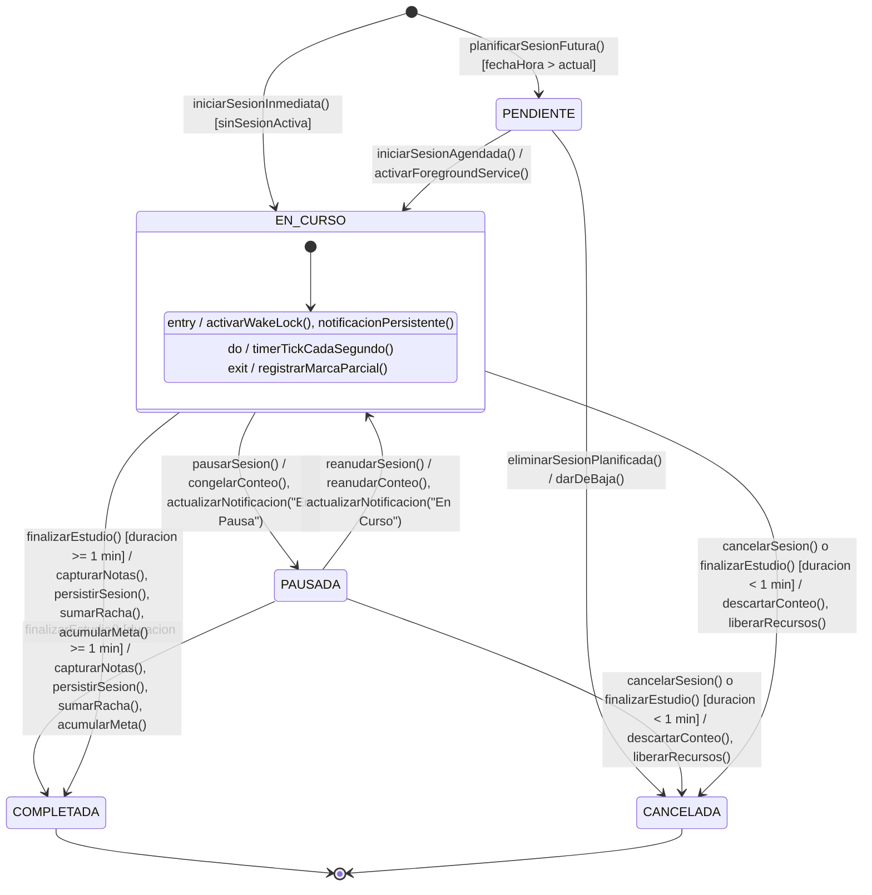

# StudyVibe: Diagrama de Estados - Ciclo de Vida de la Sesión de Estudio

> **Institución:** Universidad Privada Domingo Savio (UPDS)  
> **Facultad:** Ingeniería  
> **Carrera:** Ingeniería de Sistemas  
> **Materia:** Aplicaciones Móviles I  
> **Docente:** Ing. Daniel Román Terrazas  
> **Estudiante:** David Gorena  
> **Gestión:** II / 2026  
> **Tipo de Diagrama:** Diagrama de Máquina de Estados UML (State Machine Diagram)  
> **Herramienta de Modelado:** Enterprise Architect (EA) / Mermaid UML  
> **Entidad Representada:** `SesionEstudio` y su tipo enumerado `EstadoSesion`  

---

## 1. Fundamentación Teórica del Diagrama de Estados

En la ingeniería de software orientada a objetos (Pressman & Maxim, 2020), el **Diagrama de Máquina de Estados** modela el comportamiento dinámico de una entidad discreta en respuesta a eventos discretos del entorno. En **StudyVibe**, la entidad `SesionEstudio` posee un ciclo de vida no trivial que debe garantizar:
1. La exclusividad de que solo una sesión pueda estar activamente cronometrándose a la vez (`RN-SES-03`).
2. La retención matemática del tiempo acumulado ante pausas intermitentes (`RN-SES-04`).
3. El filtrado de sesiones espurias o accidentales (umbral mínimo de 1 minuto para persistir como completada, `RN-SES-05`).
4. La ausencia de bloqueos o estados inconsistentes en la base de datos local SQLite ante cierres forzados del sistema.

---

## 2. Diagrama de Estados UML (Código Mermaid)

---

## 3. Matriz Formal de Transición de Estados

La siguiente tabla especifica formalmente las transiciones del modelo de estados para su verificación y trazabilidad:

| Estado Origen | Evento / Disparador | Condición de Guarda | Acción / Efecto del Sistema | Estado Destino |
| :--- | :--- | :--- | :--- | :--- |
| **`[*]` (Inicial)** | `planificarSesionFutura()` | `[fechaHora > actual]` | Inserta registro en Room con `estado = 'PENDIENTE'`. | `PENDIENTE` |
| **`[*]` (Inicial)** | `iniciarSesionInmediata()` | `[sinSesionActiva]` | Crea entidad, arranca `StudyTimerService` y proyecta notificación. | `EN_CURSO` |
| **`PENDIENTE`** | `iniciarSesionAgendada()` | `[sinSesionActiva]` | Asigna `fechaHoraInicio = now()` e inicia el servicio en primer plano. | `EN_CURSO` |
| **`PENDIENTE`** | `eliminarSesion()` | Ninguna | Elimina o cancela el registro agendado de la base de datos. | `CANCELADA` |
| **`EN_CURSO`** | `pausarSesion()` | Ninguna | Detiene el incremento de segundos; retiene la duración acumulada. | `PAUSADA` |
| **`PAUSADA`** | `reanudarSesion()` | Ninguna | Reanuda el reloj; actualiza la notificación a modo activo. | `EN_CURSO` |
| **`EN_CURSO` / `PAUSADA`** | `finalizarEstudio()` | `[duracion >= 1 min]` | Guarda notas temáticas, marca `COMPLETADA`, suma racha y horas a la meta. | `COMPLETADA` |
| **`EN_CURSO` / `PAUSADA`** | `finalizarEstudio()` | `[duracion < 1 min]` | Descarta la sesión por ser inferior al umbral mínimo (`RN-SES-05`). | `CANCELADA` |
| **`EN_CURSO` / `PAUSADA`** | `cancelarSesion()` | Ninguna | Descarta la sesión voluntariamente sin alterar racha ni metas. | `CANCELADA` |
| **`COMPLETADA`** | `[*]` (Final) | - | El registro queda inmutable para analítica y reportes históricos. | `[*]` |
| **`CANCELADA`** | `[*]` (Final) | - | El registro se limpia o conserva como cancelación sin impacto en métricas. | `[*]` |

---

## 4. Guía para Enterprise Architect (EA) y Dibujo a Mano

Si vas a replicar este diagrama en **Enterprise Architect (EA)** o a dibujarlo a mano:

1. **Tipo de Diagrama en EA:** Crear un *State Machine Diagram* (Diagrama de Máquina de Estados UML).
2. **Nodos y Elementos:**
   * **Initial State (`[*]`):** Círculo relleno negro.
   * **Estados (`State`):** Rectángulos con bordes redondeados (`PENDIENTE`, `EN_CURSO`, `PAUSADA`, `COMPLETADA`, `CANCELADA`).
   * **Sub-estado en `EN_CURSO`:** Se puede modelar como un estado compuesto o con acciones internas:
     * `entry / activarWakeLock()`
     * `do / cronometrarSegundos()`
     * `exit / registrarMarca()`
   * **Final States (`[*]`):** Círculo relleno negro con anillo exterior circunscrito (aplicado tras `COMPLETADA` y `CANCELADA`).
3. **Transiciones:**
   * Flechas dirigidas etiquetadas con la sintaxis estándar UML:
     $$\text{Evento}[\text{Guard}] \ / \ \text{Acción}$$
   * Ejemplo para la transición clave de éxito:
     `finalizarEstudio()[duracion >= 1 min] / persistir(), sumarRacha()`
