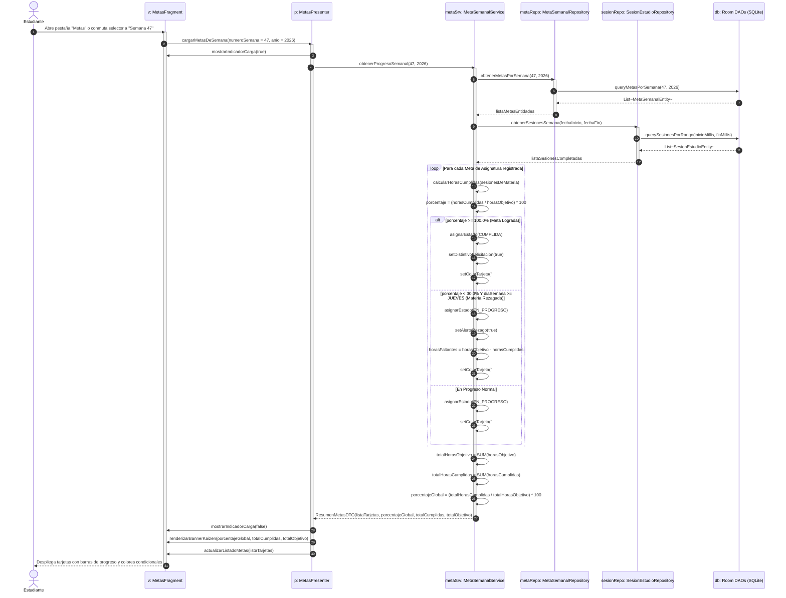

# StudyVibe: Diagrama de Secuencia 2 - Cálculo y Evaluación de Metas Semanales

> **Institución:** Universidad Privada Domingo Savio (UPDS)  
> **Facultad:** Ingeniería  
> **Carrera:** Ingeniería de Sistemas  
> **Materia:** Aplicaciones Móviles I  
> **Docente:** Ing. Daniel Román Terrazas  
> **Estudiante:** David Gorena  
> **Gestión:** II / 2026  
> **Tipo de Diagrama:** Diagrama de Secuencia UML (Comportamiento Dinámico)  
> **Herramienta de Modelado:** Enterprise Architect (EA) / Mermaid UML  
> **Algoritmo Representado:** Algoritmo 2 - Cálculo Dinámico, Evaluación de Progreso Semanal y Detección Temprana de Materias Rezagadas (Filosofía Kaizen)  

---

## 1. Descripción del Algoritmo

Este algoritmo implementa la lógica analítica de seguimiento del compromiso académico semanal:
1. El **Estudiante** accede a la pantalla de Metas Semanales o conmuta el selector de semanas lectivas.
2. La vista pasiva `MetasFragment` solicita al presentador `MetasPresenter` la carga del estado académico del periodo.
3. El presentador muestra un indicador de carga transitorio y solicita el balance semanal a `MetaSemanalService`.
4. El servicio consulta en SQLite a través de Room las metas fijadas (`MetaSemanalDao`) y las sesiones de estudio completadas en el rango de fechas de dicha semana (`SesionEstudioDao`).
5. El algoritmo ejecuta un bucle iterativo sobre cada asignatura, calculando matemáticamente:
   $$\text{Porcentaje de Cumplimiento} = \left(\frac{\text{Horas Cumplidas}}{\text{Horas Objetivo}}\right) \times 100$$
6. Para cada materia se evalúan las reglas condicionales del negocio:
   * **Caso 1 (Meta Cumplida $\ge 100\%$):** Asigna el estado `CUMPLIDA`, activa la tarjeta en color verde de éxito y adjunta el distintivo de felicitación.
   * **Caso 2 (Alerta de Rezagado $< 30\%$ y día posterior al miércoles):** Asigna una bandera de alerta de procrastinación, colorea la tarjeta en ámbar/rojo y calcula las horas exactas pendientes para alcanzar el objetivo.
   * **Caso 3 (En Progreso):** Mantiene la barra de progreso azul proporcional.
7. Se calcula el agregado global de horas para la tarjeta superior de compromiso Kaizen.
8. El presentador entrega los datos formateados a la vista para el renderizado final sin bloqueos de interfaz.

---

## 2. Diagrama de Secuencia UML (Código Mermaid)

---

## 3. Especificación de Mensajes y Guía para Enterprise Architect (EA)

Si vas a replicar este diagrama en **Enterprise Architect (EA)** o a dibujarlo a mano:

1. **Tipo de Diagrama en EA:** Crear un *Sequence Diagram* (Diagrama de Secuencia UML).
2. **Líneas de Vida (*Lifelines*):**
   * `Estudiante`: Actor UML.
   * `v: MetasFragment`: Línea de vida de interfaz pasiva (`<<boundary>>` o `<<view>>`).
   * `p: MetasPresenter`: Línea de vida controladora (`<<control>>` o `<<presenter>>`).
   * `metaSrv: MetaSemanalService`: Servicio del dominio que encapsula las fórmulas de cálculo (`<<service>>`).
   * `metaRepo` y `sesionRepo`: Contratos de repositorio (`<<repository>>`).
   * `db: Room DAOs`: Persistencia física SQLite (`<<entity>>` o `<<database>>`).
3. **Fragmentos Combinados (*Combined Fragments*):**
   * **Bucle (`loop`):** Con condición `[Para cada Meta de Asignatura registrada]`.
   * **Alternativa (`alt`):** Con tres operandos bien definidos:
     * `[porcentaje >= 100.0%]` $\rightarrow$ Verde éxito con felicitación.
     * `[porcentaje < 30.0% Y diaSemana >= Jueves]` $\rightarrow$ Ámbar de alerta temprana por rezago.
     * `[else]` $\rightarrow$ Azul estándar en progreso.
4. **Semántica de Mensajes:**
   * Mensajes de llamada sincrónica para las peticiones de cálculo (`obtenerProgresoSemanal()`).
   * Mensajes reflejos (*Self Messages*) en `metaSrv` para denotar cálculos aritméticos internos sin llamadas externas.
   * Retorno asíncrono con el objeto consolidado `ResumenMetasDTO`.
