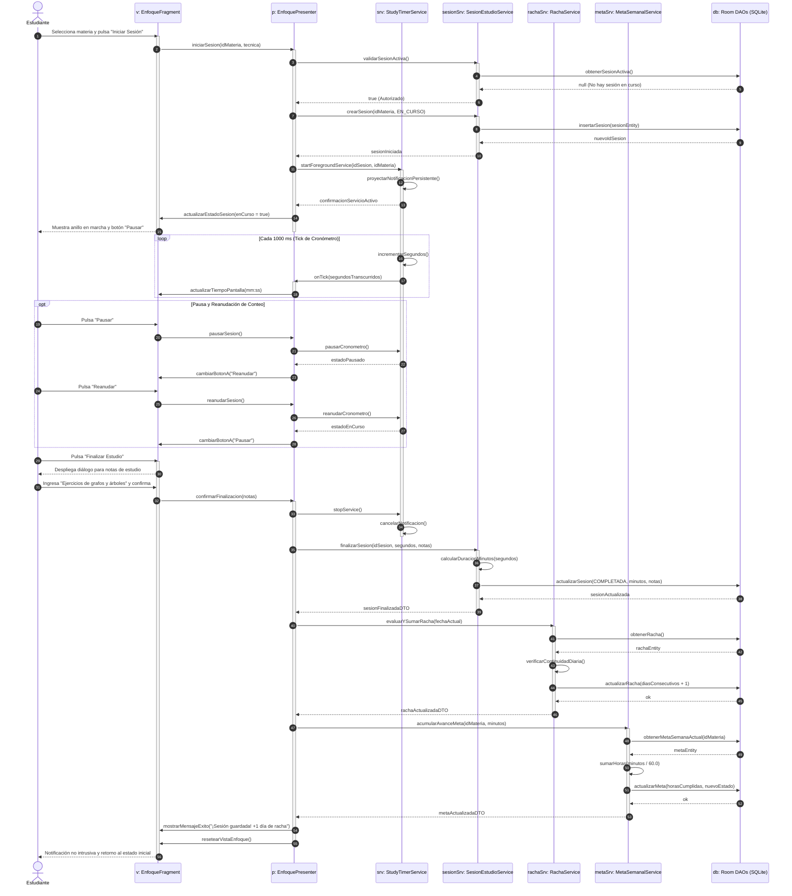

# StudyVibe: Diagrama de Secuencia 1 - Ejecución de Sesión de Estudio

> **Institución:** Universidad Privada Domingo Savio (UPDS)  
> **Facultad:** Ingeniería  
> **Carrera:** Ingeniería de Sistemas  
> **Materia:** Aplicaciones Móviles I  
> **Docente:** Ing. Daniel Román Terrazas  
> **Estudiante:** David Gorena  
> **Gestión:** II / 2026  
> **Tipo de Diagrama:** Diagrama de Secuencia UML (Comportamiento Dinámico)  
> **Herramienta de Modelado:** Enterprise Architect (EA) / Mermaid UML  
> **Algoritmo Representado:** Algoritmo 1 - Inicio, Control en Tiempo Real, Notificación Persistente y Finalización de Sesión de Estudio con Actualización de Racha Kaizen y Metas Semanales  

---

## 1. Descripción del Algoritmo

Este algoritmo representa el caso de uso central del sistema StudyVibe:
1. El **Estudiante** selecciona la materia y pulsa *"Iniciar Sesión"*.
2. La vista pasiva `EnfoqueFragment` delega al presentador `EnfoquePresenter`.
3. El presentador valida que no exista otra sesión activa mediante `SesionEstudioService` y arranca el servicio en primer plano `StudyTimerService`.
4. El servicio proyecta una notificación no cancelable en la barra de estado y emite *ticks* de actualización cada 1000 ms hacia la interfaz.
5. El alumno puede pausar y reanudar el conteo sin perder los segundos acumulados (*fragmento alternativo*).
6. Al concluir el estudio, el alumno pulsa *"Finalizar Estudio"* y registra notas cualitativas.
7. El presentador detiene el servicio, calcula la duración neta, cambia el estado a `COMPLETADA` y persiste en SQLite.
8. De forma automática y atómica, se invoca a `RachaService` para sumar +1 día a la racha consecutiva y a `MetaSemanalService` para acumular los minutos estudiados a la meta semanal de la materia.

---

## 2. Diagrama de Secuencia UML (Código Mermaid)

---

## 3. Especificación de Mensajes y Guía para Enterprise Architect (EA)

Si vas a replicar este diagrama en **Enterprise Architect (EA)** o dibujarlo a mano:

1. **Tipo de Diagrama en EA:** Crear un *Sequence Diagram* (Diagrama de Secuencia UML).
2. **Líneas de Vida (*Lifelines*):**
   * `Estudiante`: Actor UML.
   * `v: EnfoqueFragment`: Línea de vida con estereotipo `<<boundary>>` o `<<view>>`.
   * `p: EnfoquePresenter`: Línea de vida con estereotipo `<<control>>` o `<<presenter>>`.
   * `srv: StudyTimerService`: Línea de vida de servicio Android (`<<service>>`).
   * `sesionSrv`, `rachaSrv`, `metaSrv`: Clases de servicio de dominio (`<<service>>` o `<<domain>>`).
   * `db: Room DAOs`: Línea de vida de acceso a datos (`<<entity>>` o `<<database>>`).
3. **Fragmentos Combinados (*Combined Fragments*):**
   * **Bucle (`loop`):** Con guarda `[Cada 1000 ms]` para representar el ciclo de vida del cronómetro.
   * **Opcional (`opt`):** Para la interacción de Pausa y Reanudación temporal del tiempo de enfoque.
4. **Mensajes Clave:**
   * Flechas sincrónicas con punta sólida para llamadas de método directas (`iniciarSesion()`, `validarSesionActiva()`).
   * Flechas de retorno discontinuas con punta abierta para retornos de valores (`confirmacion`, `DTOs`).
   * Desactivación y activación explícita de las barras de ejecución para ilustrar el tiempo de cómputo de cada objeto.
