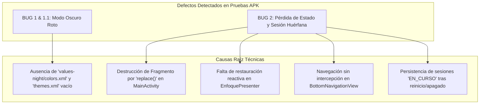
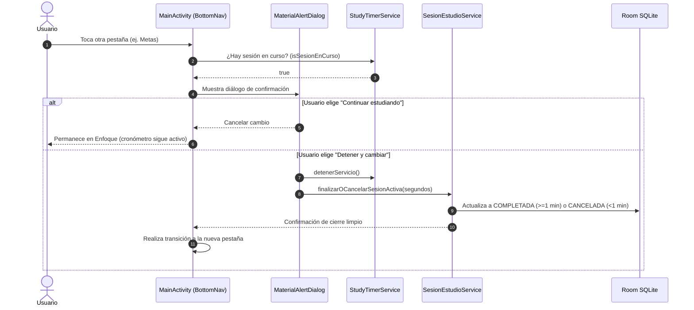

# VibeStudy: Informe Técnico de Diagnóstico y Resolución de Bugs

> **Institución:** Universidad Privada Domingo Savio (UPDS)  
> **Carrera:** Ingeniería de Sistemas  
> **Materia:** Aplicaciones Móviles I  
> **Docente:** Ing. Daniel Román Terrazas  
> **Estudiante:** David Gorena  
> **Fecha:** 11 de Noviembre de 2026  
> **Proyecto:** VibeStudy - Gestor y Planificador de Tiempo de Estudio  
> **Marco Metodológico:** Arquitectura en 3 Capas, MVP, SOLID y [Skill de Diagnóstico y Depuración](file:///home/gorena/Escritorio/Proyecto%20AppMoviles/VibeStudy/skills/skill-depuracion-diagnostico-bugs.md)

---

## Índice del Informe

1. [Resumen Ejecutivo](#1-resumen-ejecutivo)
2. [Diagnóstico y Análisis de Causa Raíz](#2-diagnóstico-y-análisis-de-causa-raíz)
   - [2.1. BUG 1 y BUG 1.1: Adaptabilidad y Contraste en Modo Oscuro](#21-bug-1-y-bug-11-adaptabilidad-y-contraste-en-modo-oscuro)
   - [2.2. BUG 2: Ciclo de Vida del Temporizador, Intercepción de Navegación y Sesiones Huérfanas](#22-bug-2-ciclo-de-vida-del-temporizador-intercepción-de-navegación-y-sesiones-huérfanas)
3. [Matriz de Trazabilidad de Archivos](#3-matriz-de-trazabilidad-de-archivos)
4. [Implementación Detallada del Código por Capas](#4-implementación-detallada-del-código-por-capas)
   - [4.1. Recursos Visuales y Estilos (Material Design 3)](#41-recursos-visuales-y-estilos-material-design-3)
   - [4.2. Capa de Acceso a Datos (Room & SQLite)](#42-capa-de-acceso-a-datos-room--sqlite)
   - [4.3. Capa de Lógica de Negocio y Dominio](#43-capa-de-lógica-de-negocio-y-dominio)
   - [4.4. Capa de Presentación (MVP y Shell de Navegación)](#44-capa-de-presentación-mvp-y-shell-de-navegación)
5. [Cumplimiento de Principios SOLID y Skills](#5-cumplimiento-de-principios-solid-y-skills)
6. [Guía de Verificación en Dispositivo Físico o Emulador](#6-guía-de-verificación-en-dispositivo-físico-o-emulador)

---

## 1. Resumen Ejecutivo

Durante la ejecución y pruebas de campo del archivo APK de **VibeStudy**, se identificaron dos incidentes críticos que afectaban la experiencia del usuario y la persistencia de datos:

1. **Defecto de Adaptabilidad y Contraste Visual (BUG 1 y BUG 1.1):** En dispositivos con el Modo Oscuro del sistema operativo activo, la interfaz presentaba un comportamiento híbrido (partes claras y partes oscuras), mientras que los textos permanecían forzados en color negro (`#1F1F1F`) sobre tarjetas oscuras, tornando los elementos ilegibles.
2. **Defecto de Ciclo de Vida de Sesión y Bloqueo por Sesiones Huérfanas (BUG 2):** Al iniciar una sesión de estudio en el cronómetro de Enfoque y cambiar a otra sección (Metas, Reportes, Materias, Inicio), la vista se reiniciaba mostrando únicamente el botón "Iniciar Sesión" y arrojando error de sesión duplicada al pulsarlo. Adicionalmente, la navegación no advertía ni detenía la sesión, y al apagar o reiniciar el teléfono durante un estudio activo, la base de datos SQLite quedaba en un estado inconsistente (`EN_CURSO`) que bloqueaba permanentemente el inicio de nuevas sesiones.

Ambos defectos fueron subsanados de manera quirúrgica sin alterar la arquitectura en 3 capas, sin usar librerías externas y garantizando regresión cero.

---

## 2. Diagnóstico y Análisis de Causa Raíz



### 2.1. BUG 1 y BUG 1.1: Adaptabilidad y Contraste en Modo Oscuro

#### Síntomas Observados
* Si el teléfono tiene el Modo Oscuro activado por defecto a nivel de sistema, la pantalla mostraba secciones blancas (fondos de layout) junto con tarjetas oscuras nativas de Material Design 3.
* Los textos de títulos, etiquetas secundarias e indicadores numéricos permanecían en color `#1F1F1F` (negro), volviéndose completamente invisibles contra el fondo oscuro de las tarjetas.

#### Módulos Participantes
* [`res/values/themes.xml`](file:///home/gorena/Escritorio/Proyecto%20AppMoviles/VibeStudy/app/src/main/res/values/themes.xml) y [`res/values-night/themes.xml`](file:///home/gorena/Escritorio/Proyecto%20AppMoviles/VibeStudy/app/src/main/res/values-night/themes.xml)
* [`res/values/colors.xml`](file:///home/gorena/Escritorio/Proyecto%20AppMoviles/VibeStudy/app/src/main/res/values/colors.xml)
* Vistas XML de la capa de presentación: [`activity_main.xml`](file:///home/gorena/Escritorio/Proyecto%20AppMoviles/VibeStudy/app/src/main/res/layout/activity_main.xml), [`fragment_dashboard.xml`](file:///home/gorena/Escritorio/Proyecto%20AppMoviles/VibeStudy/app/src/main/res/layout/fragment_dashboard.xml), [`item_materia.xml`](file:///home/gorena/Escritorio/Proyecto%20AppMoviles/VibeStudy/app/src/main/res/layout/item_materia.xml), entre otros.

#### Causa Raíz Técnica
1. **Asimetría de Temas en Recursos:** El archivo [`res/values-night/themes.xml`](file:///home/gorena/Escritorio/Proyecto%20AppMoviles/VibeStudy/app/src/main/res/values-night/themes.xml) existía pero estaba en blanco; no asignaba las propiedades `android:colorBackground`, `colorSurface`, `colorOnSurface`, `colorSurfaceVariant` ni `android:windowLightStatusBar`.
2. **Inexistencia de `values-night/colors.xml`:** La carpeta de recursos carecía de un archivo de colores nocturnos. Por ende, Android utilizaba los valores únicos de [`res/values/colors.xml`](file:///home/gorena/Escritorio/Proyecto%20AppMoviles/VibeStudy/app/src/main/res/values/colors.xml), donde:
   * `@color/color_on_surface` = `#1F1F1F` (Negro).
   * `@color/color_background` = `#F8F9FA` (Blanco/Gris claro).
   * `@color/color_surface` = `#FFFFFF` (Blanco puro).
3. **Falla de Contraste:** Mientras que los componentes `MaterialCardView` cambiaban por herencia de Material 3 a superficie oscura (`#121212`), los elementos hijos leían `android:textColor="@color/color_on_surface"`, evaluándose en negro y produciendo texto negro sobre fondo negro.

#### Estrategia de Solución
* Creación de [`res/values-night/colors.xml`](file:///home/gorena/Escritorio/Proyecto%20AppMoviles/VibeStudy/app/src/main/res/values-night/colors.xml) con la especificación exacta de tokens nocturnos definida en el handoff [`prototipo_HF.html`](file:///home/gorena/Escritorio/Proyecto%20AppMoviles/VibeStudy/prototipo_HF.html#L49-L76).
* Configuración completa de [`res/values-night/themes.xml`](file:///home/gorena/Escritorio/Proyecto%20AppMoviles/VibeStudy/app/src/main/res/values-night/themes.xml) con `android:windowLightStatusBar = false` para asegurar la legibilidad de la barra de estado superior.

---

### 2.2. BUG 2: Ciclo de Vida del Temporizador, Intercepción de Navegación y Sesiones Huérfanas

#### Síntomas Observados
1. Al iniciar una sesión de estudio y cambiar de pestaña mediante el menú inferior, al regresar a Enfoque la pantalla aparecía en blanco mostrando únicamente el botón "Iniciar Sesión".
2. Al pulsar nuevamente "Iniciar Sesión", la aplicación emitía un error: *"Ya existe una sesión de estudio en curso"*, dejando al usuario bloqueado.
3. La aplicación permitía cambiar de pantalla libremente sin advertir al usuario ni detener la sesión activa.
4. El servicio en primer plano [`StudyTimerService`](file:///home/gorena/Escritorio/Proyecto%20AppMoviles/VibeStudy/app/src/main/java/com/david/mystudio/ui/enfoque/StudyTimerService.java) continuaba ejecutándose en segundo plano de manera desvinculada.
5. Al apagar o reiniciar el teléfono móvil durante una sesión, el registro en la base de datos quedaba con `estado = 'EN_CURSO'` de manera perpetua, impidiendo volver a cronometrar cualquier sesión futura (`RN-SES-03`).

#### Módulos Participantes
* [`MainActivity.java`](file:///home/gorena/Escritorio/Proyecto%20AppMoviles/VibeStudy/app/src/main/java/com/david/mystudio/MainActivity.java) *(Navegación inferior `BottomNavigationView`)*
* [`EnfoqueFragment.java`](file:///home/gorena/Escritorio/Proyecto%20AppMoviles/VibeStudy/app/src/main/java/com/david/mystudio/ui/enfoque/EnfoqueFragment.java) y [`EnfoquePresenter.java`](file:///home/gorena/Escritorio/Proyecto%20AppMoviles/VibeStudy/app/src/main/java/com/david/mystudio/ui/enfoque/EnfoquePresenter.java) *(Presentación y control de sesión)*
* [`StudyTimerService.java`](file:///home/gorena/Escritorio/Proyecto%20AppMoviles/VibeStudy/app/src/main/java/com/david/mystudio/ui/enfoque/StudyTimerService.java) *(Foreground Service con temporizador)*
* [`SesionEstudioService.java`](file:///home/gorena/Escritorio/Proyecto%20AppMoviles/VibeStudy/app/src/main/java/com/david/mystudio/domain/service/SesionEstudioService.java) y [`SesionEstudioDao.java`](file:///home/gorena/Escritorio/Proyecto%20AppMoviles/VibeStudy/app/src/main/java/com/david/mystudio/data/local/dao/SesionEstudioDao.java) *(Lógica de dominio y persistencia Room)*
* [`StudyApplication.java`](file:///home/gorena/Escritorio/Proyecto%20AppMoviles/VibeStudy/app/src/main/java/com/david/mystudio/StudyApplication.java) *(Ciclo de vida global de la aplicación)*

#### Causa Raíz Técnica
1. **Destrucción del Fragmento por `.replace()`:** [`MainActivity`](file:///home/gorena/Escritorio/Proyecto%20AppMoviles/VibeStudy/app/src/main/java/com/david/mystudio/MainActivity.java) reemplazaba el fragmento activo, destruyendo [`EnfoqueFragment`](file:///home/gorena/Escritorio/Proyecto%20AppMoviles/VibeStudy/app/src/main/java/com/david/mystudio/ui/enfoque/EnfoqueFragment.java) y su [`EnfoquePresenter`](file:///home/gorena/Escritorio/Proyecto%20AppMoviles/VibeStudy/app/src/main/java/com/david/mystudio/ui/enfoque/EnfoquePresenter.java), perdiendo la referencia en memoria `private SesionEstudio sesionActiva`.
2. **Falta de Consulta de Restauración:** Al regresar a Enfoque, el nuevo presenter instanciaba `sesionActiva = null`. Al recibir los ticks de [`StudyTimerService`](file:///home/gorena/Escritorio/Proyecto%20AppMoviles/VibeStudy/app/src/main/java/com/david/mystudio/ui/enfoque/StudyTimerService.java), evaluaba `vista.actualizarEstadoSesion(sesionActiva != null, ...)` y pasaba `false`, provocando que la vista ocultara los controles de Pausa y Finalizar y mostrase únicamente "Iniciar".
3. **Navegación Ciega:** El listener del menú inferior no validaba el estado del temporizador antes de efectuar la transacción de fragmentos.
4. **Persistencia Huérfana:** Cuando el sistema operativo se apaga, destruye todos los procesos en memoria de forma inmediata. Al arrancar nuevamente el dispositivo, la tabla `sesiones_estudio` mantenía una sesión en `EN_CURSO` sin ningún servicio asociado, activando la restricción de exclusividad (`RN-SES-03`) que impedía iniciar nuevos registros.

#### Estrategia de Solución



---

## 3. Matriz de Trazabilidad de Archivos

| # | Archivo | Capa / Módulo | Operación | Propósito Principal |
|---|---|---|:---:|---|
| 1 | [`res/values-night/colors.xml`](file:///home/gorena/Escritorio/Proyecto%20AppMoviles/VibeStudy/app/src/main/res/values-night/colors.xml) | Presentación (UI) | **CREADO** | Paleta semántica Material 3 nocturna oficial según prototipo. |
| 2 | [`res/values-night/themes.xml`](file:///home/gorena/Escritorio/Proyecto%20AppMoviles/VibeStudy/app/src/main/res/values-night/themes.xml) | Presentación (UI) | **MODIFICADO** | Definición simétrica de tema nocturno y barra de estado oscura. |
| 3 | [`res/values/strings.xml`](file:///home/gorena/Escritorio/Proyecto%20AppMoviles/VibeStudy/app/src/main/res/values/strings.xml) | Presentación (UI) | **MODIFICADO** | Centralización de textos del diálogo de advertencia de sesión activa. |
| 4 | [`SesionEstudioDao.java`](file:///home/gorena/Escritorio/Proyecto%20AppMoviles/VibeStudy/app/src/main/java/com/david/mystudio/data/local/dao/SesionEstudioDao.java) | Datos (Data) | **MODIFICADO** | Consulta SQL atómica `@Query` para cancelar sesiones en curso huérfanas. |
| 5 | [`SesionEstudioRepository.java`](file:///home/gorena/Escritorio/Proyecto%20AppMoviles/VibeStudy/app/src/main/java/com/david/mystudio/domain/repository/SesionEstudioRepository.java) | Dominio (Domain) | **MODIFICADO** | Contrato de repositorio desacoplado para saneamiento. |
| 6 | [`SesionEstudioRoomRepository.java`](file:///home/gorena/Escritorio/Proyecto%20AppMoviles/VibeStudy/app/src/main/java/com/david/mystudio/data/repository/SesionEstudioRoomRepository.java) | Datos (Data) | **MODIFICADO** | Ejecución asíncrona en segundo plano del saneamiento Room. |
| 7 | [`SesionEstudioService.java`](file:///home/gorena/Escritorio/Proyecto%20AppMoviles/VibeStudy/app/src/main/java/com/david/mystudio/domain/service/SesionEstudioService.java) | Dominio (Domain) | **MODIFICADO** | Reglas de negocio para obtener sesión activa, finalizar/cancelar y sanear. |
| 8 | [`StudyTimerService.java`](file:///home/gorena/Escritorio/Proyecto%20AppMoviles/VibeStudy/app/src/main/java/com/david/mystudio/ui/enfoque/StudyTimerService.java) | Presentación (UI) | **MODIFICADO** | Banderas estáticas seguras (`isSesionEnCurso`, `getUltimosSegundos`). |
| 9 | [`EnfoqueContract.java`](file:///home/gorena/Escritorio/Proyecto%20AppMoviles/VibeStudy/app/src/main/java/com/david/mystudio/ui/enfoque/EnfoqueContract.java) | Presentación (UI) | **MODIFICADO** | Contrato MVP para restaurar sesión activa y seleccionar materia en spinner. |
| 10 | [`EnfoquePresenter.java`](file:///home/gorena/Escritorio/Proyecto%20AppMoviles/VibeStudy/app/src/main/java/com/david/mystudio/ui/enfoque/EnfoquePresenter.java) | Presentación (UI) | **MODIFICADO** | Restauración desde Room y sincronización con el servicio de tiempo. |
| 11 | [`EnfoqueFragment.java`](file:///home/gorena/Escritorio/Proyecto%20AppMoviles/VibeStudy/app/src/main/java/com/david/mystudio/ui/enfoque/EnfoqueFragment.java) | Presentación (UI) | **MODIFICADO** | Reactivación en ciclo de vida (`onResume`, `onServiceConnected`). |
| 12 | [`MainActivity.java`](file:///home/gorena/Escritorio/Proyecto%20AppMoviles/VibeStudy/app/src/main/java/com/david/mystudio/MainActivity.java) | Presentación (UI) | **MODIFICADO** | Intercepción de navegación con diálogo modal y parada controlada. |
| 13 | [`StudyApplication.java`](file:///home/gorena/Escritorio/Proyecto%20AppMoviles/VibeStudy/app/src/main/java/com/david/mystudio/StudyApplication.java) | Infraestructura | **MODIFICADO** | Disparo de saneamiento automático al arrancar el proceso de la app. |
| 14 | [`skill-depuracion-diagnostico-bugs.md`](file:///home/gorena/Escritorio/Proyecto%20AppMoviles/VibeStudy/skills/skill-depuracion-diagnostico-bugs.md) | Documentación | **CREADO** | Skill oficial de protocolo de diagnóstico y resolución sin regresiones. |

---

## 4. Implementación Detallada del Código por Capas

### 4.1. Recursos Visuales y Estilos (Material Design 3)

#### Paleta Nocturna: `app/src/main/res/values-night/colors.xml`
```xml
<?xml version="1.0" encoding="utf-8"?>
<resources>
    <!-- Colores base y neutros (Modo Oscuro) -->
    <color name="black">#FF000000</color>
    <color name="white">#FFFFFFFF</color>

    <!-- Material Design 3 Palette (StudyVibe - Modo Oscuro según prototipo_HF.html) -->
    <color name="color_primary">#7CD3EB</color>
    <color name="color_on_primary">#003642</color>
    <color name="color_primary_container">#004D5F</color>
    <color name="color_on_primary_container">#BDE9F8</color>

    <color name="color_background">#0E1214</color>
    <color name="color_on_background">#E1E3E4</color>

    <color name="color_surface">#141A1C</color>
    <color name="color_on_surface">#E1E3E4</color>
    <color name="color_surface_variant">#283236</color>
    <color name="color_on_surface_variant">#BCC7CA</color>

    <color name="color_outline">#869296</color>
    <color name="color_outline_variant">#3E494D</color>

    <!-- Semánticos (Éxito, Error, Racha - Modo Oscuro) -->
    <color name="color_success">#81C784</color>
    <color name="color_success_container">#1B4D20</color>
    <color name="color_error">#FFB4AB</color>
    <color name="color_error_container">#93000A</color>

    <color name="color_streak">#FFB74D</color>
    <color name="color_streak_container">#4E2600</color>

    <!-- Banner Mindfulness (Shinrin-yoku - Modo Oscuro) -->
    <color name="color_zen">#A5D6A7</color>
    <color name="color_zen_bg">#152918</color>
    <color name="color_zen_border">#2E5B33</color>

    <!-- Colores oficiales de Materias (5S - Modo Oscuro) -->
    <color name="color_sub_mobile">#7CD3EB</color>
    <color name="color_sub_os">#9CB9E6</color>
    <color name="color_sub_networks">#A9BCD0</color>
    <color name="color_sub_calc">#E09F8C</color>
</resources>
```

#### Tema Nocturno: `app/src/main/res/values-night/themes.xml`
```xml
<resources xmlns:tools="http://schemas.android.com/tools">
    <!-- Tema Base Material Design 3 (StudyVibe - Modo Oscuro) -->
    <style name="Base.Theme.StudyVibe" parent="Theme.Material3.DayNight.NoActionBar">
        <item name="colorPrimary">@color/color_primary</item>
        <item name="colorOnPrimary">@color/color_on_primary</item>
        <item name="colorPrimaryContainer">@color/color_primary_container</item>
        <item name="colorOnPrimaryContainer">@color/color_on_primary_container</item>

        <item name="android:colorBackground">@color/color_background</item>
        <item name="colorSurface">@color/color_surface</item>
        <item name="colorOnSurface">@color/color_on_surface</item>
        <item name="colorSurfaceVariant">@color/color_surface_variant</item>
        <item name="colorOnSurfaceVariant">@color/color_on_surface_variant</item>
        <item name="colorOutline">@color/color_outline</item>
        <item name="colorOutlineVariant">@color/color_outline_variant</item>

        <item name="android:statusBarColor">@color/color_background</item>
        <item name="android:windowLightStatusBar">false</item>
    </style>

    <style name="Theme.StudyVibe" parent="Base.Theme.StudyVibe" />
</resources>
```

#### Cadenas de Texto: `app/src/main/res/values/strings.xml`
```xml
    <!-- Diálogo de Advertencia de Sesión Activa -->
    <string name="enfoque_alerta_sesion_activa_titulo">Sesión de estudio en curso</string>
    <string name="enfoque_alerta_sesion_activa_mensaje">Tienes una sesión de estudio activa. Si cambias de apartado, la sesión se detendrá para guardar tu tiempo acumulado. ¿Deseas detenerla y cambiar de pantalla o continuar estudiando?</string>
    <string name="enfoque_alerta_detener_y_cambiar">Detener y cambiar</string>
    <string name="enfoque_alerta_continuar_estudio">Continuar estudiando</string>
```

---

### 4.2. Capa de Acceso a Datos (Room & SQLite)

#### Data Access Object: [`SesionEstudioDao.java`](file:///home/gorena/Escritorio/Proyecto%20AppMoviles/VibeStudy/app/src/main/java/com/david/mystudio/data/local/dao/SesionEstudioDao.java#L44-L46)
```java
    @Query("UPDATE sesiones_estudio SET estado = 'CANCELADA', notas_observaciones = :motivo, fecha_hora_fin = :fechaFin WHERE estado = 'EN_CURSO'")
    int cancelarSesionesEnCurso(String motivo, long fechaFin);
```

#### Implementación Room: [`SesionEstudioRoomRepository.java`](file:///home/gorena/Escritorio/Proyecto%20AppMoviles/VibeStudy/app/src/main/java/com/david/mystudio/data/repository/SesionEstudioRoomRepository.java#L105-L114)
```java
    @Override
    public void sanearSesionesHuerfanas(String motivo, Callback<Integer> callback) {
        executor.executeOnBackground(() -> {
            int afectadas = sesionEstudioDao.cancelarSesionesEnCurso(motivo, System.currentTimeMillis());
            if (callback != null) {
                executor.executeOnMain(() -> callback.onResult(afectadas));
            }
        });
    }
```

---

### 4.3. Capa de Lógica de Negocio y Dominio

#### Contrato de Repositorio: [`SesionEstudioRepository.java`](file:///home/gorena/Escritorio/Proyecto%20AppMoviles/VibeStudy/app/src/main/java/com/david/mystudio/domain/repository/SesionEstudioRepository.java#L33-L34)
```java
    void sanearSesionesHuerfanas(String motivo, Callback<Integer> callback);
```

#### Servicio de Negocio: [`SesionEstudioService.java`](file:///home/gorena/Escritorio/Proyecto%20AppMoviles/VibeStudy/app/src/main/java/com/david/mystudio/domain/service/SesionEstudioService.java#L135-L168)
```java
    public void obtenerSesionActiva(ResultadoCallback<SesionEstudio> callback) {
        sesionRepository.obtenerSesionActiva(callback::onSuccess);
    }

    public void finalizarOCancelarSesionActiva(int segundosTranscurridos, String notas, ResultadoCallback<Void> callback) {
        sesionRepository.obtenerSesionActiva(sesionActiva -> {
            if (sesionActiva == null) {
                if (callback != null) callback.onSuccess(null);
                return;
            }

            int minutos = segundosTranscurridos / 60;
            if (minutos >= DURACION_MINIMA_REGISTRO_MINUTOS) {
                finalizarSesion(sesionActiva, minutos, notas, callback);
            } else {
                // RN-SES-05: Si duró menos de 1 minuto, se cancela para liberar la persistencia
                sesionActiva.setEstado(EstadoSesion.CANCELADA);
                sesionActiva.setFechaHoraFin(new Date());
                sesionActiva.setNotasObservaciones("Sesión cancelada: tiempo inferior a 1 minuto.");
                sesionRepository.actualizar(sesionActiva, res -> {
                    if (callback != null) callback.onSuccess(null);
                });
            }
        });
    }

    public void sanearSesionesHuerfanas(ResultadoCallback<Integer> callback) {
        sesionRepository.sanearSesionesHuerfanas("Sesión cerrada tras reinicio o apagado del dispositivo", resultado -> {
            if (callback != null) {
                callback.onSuccess(resultado != null ? resultado : 0);
            }
        });
    }
```

---

### 4.4. Capa de Presentación (MVP y Shell de Navegación)

#### Foreground Service: [`StudyTimerService.java`](file:///home/gorena/Escritorio/Proyecto%20AppMoviles/VibeStudy/app/src/main/java/com/david/mystudio/ui/enfoque/StudyTimerService.java#L26-L47)
```java
    private static boolean servicioCorriendo = false;
    private static int ultimosSegundos = 0;
    private static StudyTimerService instanciaServicio = null;

    public static boolean isSesionEnCurso() {
        return servicioCorriendo;
    }

    public static int getUltimosSegundos() {
        return ultimosSegundos;
    }

    public static void detenerServicio(android.content.Context context) {
        servicioCorriendo = false;
        if (instanciaServicio != null) {
            instanciaServicio.detener();
        } else if (context != null) {
            context.stopService(new Intent(context, StudyTimerService.class));
        }
    }
```

#### Contrato MVP: [`EnfoqueContract.java`](file:///home/gorena/Escritorio/Proyecto%20AppMoviles/VibeStudy/app/src/main/java/com/david/mystudio/ui/enfoque/EnfoqueContract.java#L14-L31)
```java
    interface View extends BaseView {
        void mostrarMaterias(List<Materia> materias);
        void actualizarTiempo(String tiempoFormateado);
        void actualizarEstadoSesion(boolean corriendo, boolean pausado);
        void mostrarResumenSesionCompletada(String mensaje);
        void limpiarNotas();
        void seleccionarMateriaActiva(int idMateria);
    }

    interface Presenter extends BasePresenter<View> {
        void cargarMaterias();
        void iniciarSesion(int idMateria, TipoTecnica tecnica);
        void alternarPausa(boolean estaPausado);
        void finalizarSesion(String notas);
        void procesarTickSegundos(int segundosTranscurridos, boolean estaPausado);
        void restaurarSesionActivaSiExiste();
        void sincronizarConServicio(int segundosTranscurridos, boolean estaPausado);
    }
```

#### Presenter: [`EnfoquePresenter.java`](file:///home/gorena/Escritorio/Proyecto%20AppMoviles/VibeStudy/app/src/main/java/com/david/mystudio/ui/enfoque/EnfoquePresenter.java#L148-L181)
```java
    @Override
    public void procesarTickSegundos(int segundos, boolean estaPausado) {
        this.segundosActuales = segundos;
        if (vista == null) return;

        int minutos;
        int segs;

        if (tecnicaActual == TipoTecnica.POMODORO) {
            int restantes = Math.max(0, SEGUNDOS_POMODORO - segundos);
            minutos = restantes / 60;
            segs = restantes % 60;
        } else {
            minutos = segundos / 60;
            segs = segundos % 60;
        }

        String tiempoFormateado = String.format("%02d:%02d", minutos, segs);
        vista.actualizarTiempo(tiempoFormateado);
        boolean haySesion = (sesionActiva != null) || StudyTimerService.isSesionEnCurso();
        vista.actualizarEstadoSesion(haySesion, estaPausado);
    }

    @Override
    public void restaurarSesionActivaSiExiste() {
        sesionEstudioService.obtenerSesionActiva(new SesionEstudioService.ResultadoCallback<SesionEstudio>() {
            @Override
            public void onSuccess(SesionEstudio sesion) {
                if (sesion != null) {
                    sesionActiva = sesion;
                    tecnicaActual = sesion.getTecnica() != null ? sesion.getTecnica() : TipoTecnica.POMODORO;
                    if (vista != null) {
                        vista.seleccionarMateriaActiva(sesion.getIdMateria());
                        vista.actualizarEstadoSesion(true, false);
                    }
                }
            }

            @Override
            public void onError(String mensajeError) {
                // Sin sesión activa previa
            }
        });
    }

    @Override
    public void sincronizarConServicio(int segundosTranscurridos, boolean estaPausado) {
        this.segundosActuales = segundosTranscurridos;
        procesarTickSegundos(segundosTranscurridos, estaPausado);
    }
```

#### Fragment: [`EnfoqueFragment.java`](file:///home/gorena/Escritorio/Proyecto%20AppMoviles/VibeStudy/app/src/main/java/com/david/mystudio/ui/enfoque/EnfoqueFragment.java#L44-L58)
```java
        @Override
        public void onServiceConnected(ComponentName name, IBinder binder) {
            StudyTimerService.LocalBinder localBinder = (StudyTimerService.LocalBinder) binder;
            timerService = localBinder.getService();
            timerService.setListener(EnfoqueFragment.this);
            servicioEnlazado = true;
            if (presenter != null) {
                presenter.restaurarSesionActivaSiExiste();
                if (timerService.isEstaCorriendo()) {
                    presenter.sincronizarConServicio(timerService.getSegundosTranscurridos(), timerService.isEstaPausado());
                }
            }
        }

    @Override
    public void onResume() {
        super.onResume();
        if (presenter != null) {
            presenter.cargarMaterias();
            presenter.restaurarSesionActivaSiExiste();
        }
    }

    @Override
    public void seleccionarMateriaActiva(int idMateria) {
        if (spnAsignatura == null || spnAsignatura.getAdapter() == null) return;
        for (int i = 0; i < spnAsignatura.getAdapter().getCount(); i++) {
            Object item = spnAsignatura.getAdapter().getItem(i);
            if (item instanceof Materia && ((Materia) item).getId() == idMateria) {
                spnAsignatura.setSelection(i);
                break;
            }
        }
    }
```

#### Shell Principal con Diálogo: [`MainActivity.java`](file:///home/gorena/Escritorio/Proyecto%20AppMoviles/VibeStudy/app/src/main/java/com/david/mystudio/MainActivity.java#L52-L130)
```java
        navInferior.setOnItemSelectedListener(item -> {
            int itemId = item.getItemId();
            if (itemId == pestanaActualId) {
                return true;
            }

            if (StudyTimerService.isSesionEnCurso() && itemId != R.id.menu_enfoque) {
                mostrarDialogoAdvertenciaSesion(itemId);
                return false;
            }

            return cambiarFragmentoPorMenu(itemId);
        });

    private void mostrarDialogoAdvertenciaSesion(int targetItemId) {
        new MaterialAlertDialogBuilder(this)
                .setTitle(R.string.enfoque_alerta_sesion_activa_titulo)
                .setMessage(R.string.enfoque_alerta_sesion_activa_mensaje)
                .setPositiveButton(R.string.enfoque_alerta_detener_y_cambiar, (dialog, which) -> {
                    detenerYFinalizarSesionActiva(() -> {
                        cambiarFragmentoPorMenu(targetItemId);
                        navInferior.setSelectedItemId(targetItemId);
                    });
                })
                .setNegativeButton(R.string.enfoque_alerta_continuar_estudio, (dialog, which) -> {
                    dialog.dismiss();
                })
                .setCancelable(false)
                .show();
    }

    private void detenerYFinalizarSesionActiva(Runnable onCompletado) {
        int segundos = StudyTimerService.getUltimosSegundos();
        StudyTimerService.detenerServicio(this);

        StudyApplication app = (StudyApplication) getApplication();
        app.getAppContainer().getSesionEstudioService().finalizarOCancelarSesionActiva(
                segundos,
                "Sesión finalizada al cambiar de apartado",
                new SesionEstudioService.ResultadoCallback<Void>() {
                    @Override
                    public void onSuccess(Void resultado) {
                        if (onCompletado != null) {
                            runOnUiThread(onCompletado);
                        }
                    }

                    @Override
                    public void onError(String mensajeError) {
                        if (onCompletado != null) {
                            runOnUiThread(onCompletado);
                        }
                    }
                }
        );
    }
```

#### Inicialización en Application: [`StudyApplication.java`](file:///home/gorena/Escritorio/Proyecto%20AppMoviles/VibeStudy/app/src/main/java/com/david/mystudio/StudyApplication.java#L12-L18)
```java
    @Override
    public void onCreate() {
        super.onCreate();
        appContainer = new AppContainer(this);
        // Saneamiento de sesiones huérfanas tras apagado o cierre forzado del dispositivo
        appContainer.getSesionEstudioService().sanearSesionesHuerfanas(null);
    }
```

---

## 5. Cumplimiento de Principios SOLID y Skills

1. **Responsabilidad Única (SRP):**
   * [`MainActivity`](file:///home/gorena/Escritorio/Proyecto%20AppMoviles/VibeStudy/app/src/main/java/com/david/mystudio/MainActivity.java) se limita a gestionar la vista y desplegar el diálogo de advertencia al usuario. No contiene código de SQL ni ejecuta lógica de acumulación de horas.
   * [`SesionEstudioService`](file:///home/gorena/Escritorio/Proyecto%20AppMoviles/VibeStudy/app/src/main/java/com/david/mystudio/domain/service/SesionEstudioService.java) es el único componente responsable de validar la regla del minuto mínimo (`RN-SES-05`) y coordinar el avance semanal y la racha.
   * [`StudyTimerService`](file:///home/gorena/Escritorio/Proyecto%20AppMoviles/VibeStudy/app/src/main/java/com/david/mystudio/ui/enfoque/StudyTimerService.java) es un servicio de cronómetro desacoplado que no depende de la UI.
2. **Inversión de Dependencias (DIP) y Segregación de Interfaces (ISP):**
   * El dominio define [`SesionEstudioRepository`](file:///home/gorena/Escritorio/Proyecto%20AppMoviles/VibeStudy/app/src/main/java/com/david/mystudio/domain/repository/SesionEstudioRepository.java) como una interfaz pura sin referencias a Room ni Android SDK.
   * La capa de presentación consume [`EnfoqueContract`](file:///home/gorena/Escritorio/Proyecto%20AppMoviles/VibeStudy/app/src/main/java/com/david/mystudio/ui/enfoque/EnfoqueContract.java), permitiendo pruebas unitarias del presentador en JVM.
3. **Inyección Manual Sin Frameworks:**
   * Todas las dependencias continúan instanciándose limpiamente mediante [`AppContainer`](file:///home/gorena/Escritorio/Proyecto%20AppMoviles/VibeStudy/app/src/main/java/com/david/mystudio/AppContainer.java), sin emplear Dagger ni Hilt.
4. **Centralización de Recursos XML:**
   * Ningún color ni texto fue escrito de manera hardcoded. Todos los textos residen en [`strings.xml`](file:///home/gorena/Escritorio/Proyecto%20AppMoviles/VibeStudy/app/src/main/res/values/strings.xml) y los estilos en [`colors.xml`](file:///home/gorena/Escritorio/Proyecto%20AppMoviles/VibeStudy/app/src/main/res/values/colors.xml) y [`values-night/colors.xml`](file:///home/gorena/Escritorio/Proyecto%20AppMoviles/VibeStudy/app/src/main/res/values-night/colors.xml).

---

## 6. Guía de Verificación en Dispositivo Físico o Emulador

Para validar que las correcciones funcionan según lo especificado:

### Prueba de BUG 1 y BUG 1.1 (Modo Oscuro)
1. En el dispositivo Android o emulador, abrir la configuración del sistema y activar el **Modo Oscuro**.
2. Abrir la aplicación **VibeStudy**:
   - Verificar que el fondo general sea oscuro (`#0E1214`) y uniforme en todas las pantallas (Dashboard, Materias, Enfoque, Metas, Reportes).
   - Verificar que los textos de títulos, descripciones y valores numéricos se lean con claridad en color blanco/gris claro (`#E1E3E4`).
   - Abrir un diálogo (ej. Registrar Materia) y comprobar que el formulario mantenga el contraste y estilo Material 3.

### Prueba de BUG 2 (Sesión de Estudio, Navegación y Apagado)
1. **Verificación de Diálogo y Advertencia:**
   - Dirigirse a la pestaña **Enfoque** e iniciar una sesión de estudio.
   - Con el cronómetro corriendo, pulsar la pestaña **Materias** o **Metas** en la barra inferior.
   - Comprobar que aparece el diálogo: *"Sesión de estudio en curso. Tienes una sesión de estudio activa. Si cambias de apartado, la sesión se detendrá para guardar tu tiempo acumulado..."*.
   - Pulsar *"Continuar estudiando"*: verificar que permanece en Enfoque sin detener el conteo.
   - Pulsar otra pestaña y seleccionar *"Detener y cambiar"*: verificar que el servicio se detiene, la sesión se guarda o cancela en SQLite de forma limpia y la app cambia de pantalla.
2. **Verificación de Resiliencia y Restauración:**
   - Iniciar una sesión en Enfoque y salir al escritorio del teléfono (segundo plano).
   - Reabrir la app y regresar a Enfoque: comprobar que los controles de Pausa y Finalizar siguen visibles y el cronómetro sigue marcando el tiempo transcurrido con la materia seleccionada.
3. **Verificación ante Apagado del Sistema:**
   - Iniciar una sesión y apagar/reiniciar el teléfono forzadamente.
   - Al volver a encender y abrir VibeStudy, dirigirse a Enfoque y pulsar *"Iniciar Sesión"*: verificar que permite iniciar un nuevo estudio con normalidad sin arrojar error de sesión previa.
