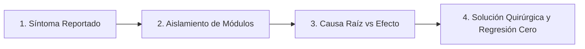

# Skill: Diagnóstico, Depuración y Resolución Segura de Bugs (skill-depuracion-diagnostico-bugs)

## 1. Propósito
Establecer un protocolo riguroso, sistemático y seguro para la detección, trazabilidad de causa raíz, documentación y corrección de defectos de software (bugs) en la aplicación **VibeStudy**. El objetivo es garantizar que cualquier modificación correctiva resuelva el defecto de raíz sin introducir regresiones, sin violar la arquitectura en 3 capas, sin quebrar los principios SOLID y manteniendo intacta la experiencia de usuario definida en el diseño de alta fidelidad.

---

## 2. Protocolo de Diagnóstico y Aislamiento en 4 Pasos

Toda revisión o corrección de defectos debe seguir obligatoriamente este flujo de 4 fases antes de alterar código de producción:



### Paso 1: Caracterización del Síntoma
* Identificar con precisión el comportamiento anómalo observable por el usuario en el dispositivo físico o emulador.
* Registrar las condiciones de disparo: versión de Android, configuración de pantalla (Modo Claro/Oscuro), eventos del ciclo de vida (cambio de pestaña, rotación, bloqueo/apagado).

### Paso 2: Mapeo y Aislamiento de Módulos Participantes
* Identificar **únicamente** los componentes del proyecto que intervienen en el flujo afectado:
  * **Capa UI:** `Activity`, `Fragment`, `DialogFragment`, `Adapter`, layouts XML, temas/colores.
  * **Capa Dominio:** `Service`, contratos de `Repository`, reglas de negocio POJO.
  * **Capa Datos:** Room `Entity`, `Dao`, mapeadores, base de datos SQLite.
  * **Servicios de Sistema:** Android `Service`, `NotificationManager`, `ServiceConnection`.
* **Regla estricta:** Si un módulo no participa en el flujo anómalo, está terminantemente prohibido modificarlo.

### Paso 3: Identificación de la Causa Raíz (Evitar "Parches Superficiales")
* Diferenciar entre el síntoma (lo que ve el usuario) y la causa estructural (dónde se origina la falta de sincronización, la pérdida de estado o la ausencia de token de color).
* No aplicar parches estéticos temporales (como `try/catch` vacíos, `null` checks que silencian fallas o colores fijos quemados) si el defecto proviene de una falta de configuración arquitectónica.

### Paso 4: Solución Quirúrgica y Verificación de No Regresión
* Diseñar la corrección respetando las skills existentes: `skill-arquitectura-capas`, `skill-solid-java`, `skill-convenciones-codigo`, `skill-diseno-xml` y `skill-persistencia-room-sqlite`.
* Comprobar que la solución mantenga la compilación limpia y ejecute las pruebas unitarias existentes (`./gradlew testDebugUnitTest`) sin errores.

---

## 3. Directrices por Categoría de Bug en Android

### 3.1. Adaptabilidad y Tematización (Modo Claro / Modo Oscuro)
1. **Separación de Recursos:**
   * La aplicación nunca debe forzar temas de forma parcial o desincronizada con el sistema operativo.
   * Toda paleta de color declarada en `res/values/colors.xml` que dependa del modo día/noche debe contar con su par exacto en `res/values-night/colors.xml`.
   * Los tokens de contraste semántico (`color_on_surface`, `color_on_background`, `color_on_primary`) deben contrastar matemáticamente con el fondo (luminosidad opuesta).
2. **Definición Simétrica de Temas:**
   * El archivo `res/values-night/themes.xml` debe sobreescribir las mismas propiedades de `Theme.Material3.DayNight` que define `res/values/themes.xml`.
   * El atributo `android:windowLightStatusBar` debe ser `true` en tema claro (iconos de barra de estado oscuros) y `false` en tema oscuro (iconos claros).
3. **Prohibición de Colores Hardcoded:**
   * Jamás usar códigos hexadecimales directos en atributos de vistas XML (`#000000`, `#FFFFFF`).
   * No referenciar `@color/black` o `@color/white` directamente para textos de contenido general; usar referencias semánticas (`@color/color_on_surface` o atributos de tema `?attr/colorOnSurface`).

### 3.2. Ciclo de Vida y Transición entre Vistas (`Activity` / `Fragment`)
1. **Pérdida de Estado en Reemplazo de Fragmentos:**
   * El método `FragmentManager.beginTransaction().replace(...)` destruye la jerarquía de vistas del fragmento anterior (`onDestroyView` y `onDestroy`).
   * Todo estado crítico (como una sesión de estudio activa o un cronómetro en marcha) **no debe residir únicamente como variable en memoria en la instancia del Fragment o de su Presenter**.
   * Debe residir en una fuente de verdad duradera: la base de datos Room (`sesiones_estudio` con estado `EN_CURSO`) o en un Servicio en segundo plano vinculado (`StudyTimerService`).
2. **Restauración Obligatoria al Reabrir la Vista:**
   * En `onViewCreated` o `onResume`, el Presenter debe consultar al Servicio de Dominio si existe una sesión activa previa para sincronizar la vista al estado correcto en lugar de inicializar en blanco.

### 3.3. Servicios en Segundo Plano y Apagado del Dispositivo
1. **Condiciones de Borde por Ciclo de Vida del S.O.:**
   * Cuando el usuario apaga el teléfono, o el sistema operativo mata el proceso de la aplicación por memoria, el servicio `Service` se destruye sin poder ejecutar `onFinalizar`.
   * **Detección de Sesiones Huérfanas:** Al reiniciar la aplicación, `SesionEstudioService` o `AppContainer` debe auditar si quedaron registros en SQLite marcados como `EN_CURSO` sin servicio activo asociado, ofreciendo recuperarlos, cerrarlos limpiamente con el tiempo estimado o cancelarlos para evitar que bloqueen futuras sesiones (`RN-SES-03`).
2. **Navegación Protegida ante Procesos Activos:**
   * Si una tarea crítica no interrumpible está en progreso (ej. sesión de enfoque Zanshin), el contenedor principal (`MainActivity`) debe interceptar los cambios de navegación.
   * Se debe notificar explícitamente al usuario mediante un diálogo modal de confirmación o detener/pausar controladamente la sesión con su consentimiento previo, en lugar de permitir transiciones silenciosas que dejen el servicio en un estado inconsistente.

---

## 4. Ejemplos de Código: Violación vs Corrección

### 4.1. Defecto de Adaptabilidad en Modo Oscuro

#### INCORRECTO: Temas asimétricos y texto negro sobre fondo oscuro
```xml
<!-- res/values/colors.xml (definido sin soporte nocturno) -->
<color name="color_on_surface">#1F1F1F</color> <!-- Siempre oscuro -->

<!-- res/values-night/themes.xml (vacío, sin configuración) -->
<style name="Base.Theme.StudyVibe" parent="Theme.Material3.DayNight.NoActionBar">
    <!-- VACÍO: Material3 oscurece la tarjeta pero el texto lee color_on_surface (#1F1F1F) -->
</style>
```

#### CORRECTO: Archivos simétricos con tokens de diseño M3
```xml
<!-- res/values/colors.xml (Modo Claro) -->
<color name="color_background">#F8F9FA</color>
<color name="color_surface">#FFFFFF</color>
<color name="color_on_surface">#1F1F1F</color>

<!-- res/values-night/colors.xml (Modo Oscuro simétrico con prototipo_HF.html) -->
<color name="color_background">#0E1214</color>
<color name="color_surface">#141A1C</color>
<color name="color_on_surface">#E1E3E4</color> <!-- Blanco / gris claro legible -->

<!-- res/values-night/themes.xml -->
<style name="Base.Theme.StudyVibe" parent="Theme.Material3.DayNight.NoActionBar">
    <item name="android:colorBackground">@color/color_background</item>
    <item name="colorSurface">@color/color_surface</item>
    <item name="colorOnSurface">@color/color_on_surface</item>
    <item name="android:windowLightStatusBar">false</item>
</style>
```

---

### 4.2. Defecto de Pérdida de Estado al Cambiar de Pestaña

#### INCORRECTO: Estado efímero en Presenter y navegación ciega en Activity
```java
// INCORRECTO: Presenter asume que es la única instancia viva y no valida persistencia
public class EnfoquePresenter {
    private SesionEstudio sesionActiva; // Se destruye al cambiar de fragmento

    public void cargarMaterias() {
        // Carga materias pero NUNCA consulta si en SQLite ya había una sesión en curso
    }
}

// En MainActivity.java: reemplazo directo sin verificar estado
navInferior.setOnItemSelectedListener(item -> {
    cambiarFragmento(new MateriasFragment()); // Mata EnfoqueFragment sin advertir al usuario
    return true;
});
```

#### CORRECTO: Intercepción de navegación y restauración reactiva
```java
// CORRECTO: 1. Presenter sincroniza con la fuente de verdad (Base de Datos / Servicio)
public class EnfoquePresenter implements EnfoqueContract.Presenter {
    @Override
    public void sincronizarEstadoSesion() {
        sesionEstudioService.obtenerSesionActiva(new ResultadoCallback<SesionEstudio>() {
            @Override
            public void onSuccess(SesionEstudio sesionExistente) {
                if (sesionExistente != null) {
                    sesionActiva = sesionExistente;
                    vista.actualizarEstadoSesion(true, false);
                }
            }
        });
    }
}

// CORRECTO: 2. MainActivity protege al usuario con diálogo de advertencia
navInferior.setOnItemSelectedListener(item -> {
    if (tieneSesionEstudioEnCurso()) {
        mostrarDialogoAdvertenciaSesion(() -> cambiarFragmentoPorMenu(item.getItemId()));
        return false; // Retiene la selección hasta confirmación del usuario
    }
    return cambiarFragmentoPorMenu(item.getItemId());
});
```

---

## 5. Checklist Obligatorio de Entrega de Corrección
Antes de dar por resuelto un bug, el desarrollador debe verificar:
- [ ] ¿Se identificaron con precisión los módulos afectados sin tocar código no relacionado?
- [ ] ¿Se eliminó la causa raíz y no solo el síntoma visual?
- [ ] ¿El archivo `values-night` y los estilos reflejan fielmente el prototipo UI/UX?
- [ ] ¿Los servicios en segundo plano y el ciclo de vida de los Fragments sincronizan su estado?
- [ ] ¿Se ejecutan con éxito todas las pruebas unitarias existentes (`./gradlew testDebugUnitTest`)?
- [ ] ¿La corrección respeta estrictamente las convenciones de nombrado, arquitectura de 3 capas y principios SOLID?
